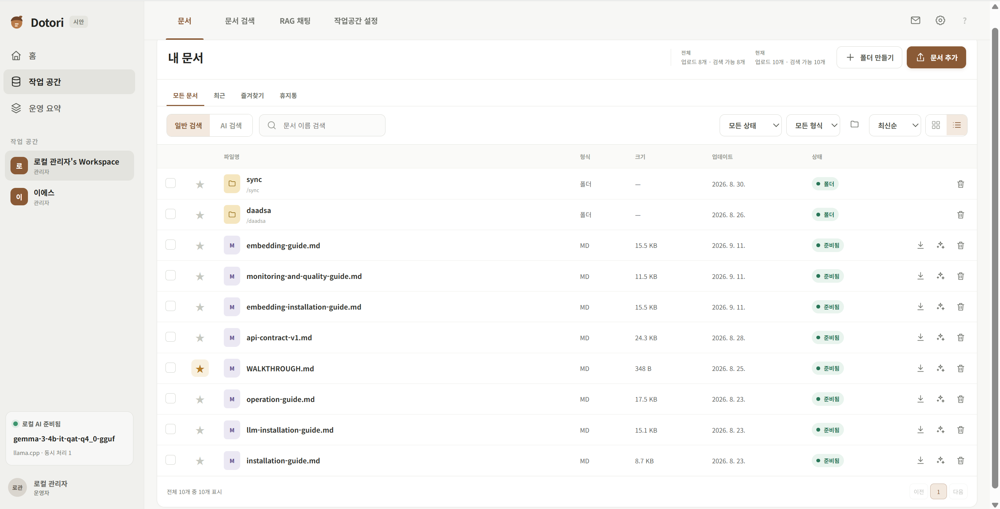

# 도토리 문서

도토리는 운영자의 파일을 AI가 활용할 수 있는 결과로 미리 준비하는 lightweight·full-stack·self-hosted 연결 기반입니다. 문서 관리·검색·RAG와 외부 읽기 전용 MCP/API가 같은 준비 결과를 재사용합니다. 현재 Documents를 제공하며 별도 Images·Audio·Videos 모듈은 향후 목표입니다. 로컬 AI 지원과 명시적인 외부 endpoint 연결을 함께 유지합니다.

개인 및 소규모 팀이 관리하는 서버 한 대를 대상으로 합니다. 선택 설치에서 사용하지 않는 모델·서비스를 올리지 않으며 실제 자원·속도는 기능과 모델에 따라 달라집니다. 준비된 결과의 외부 활용에 Dotori RAG가 필수인 것은 아닙니다.

  

영문 문서는 [README.md](README.md)를 참고하세요.  상세 내용은 [문서 안내](./dotori-docs/README.md)를 참고하세요.

## 주요 기능

- 계정과 작업 공간을 생성하여 파일과 문서 기능을 안전하게 분리할 수 있습니다
- 휴지통, 즐겨찾기, 최근 파일 등을 포함한 폴더 및 파일 관리
- 다양한 형식의 텍스트 파일의 분석 기능
- 자연어 검색을 통한 문서 검색 기능
- 문서 근거와 출처를 제공하는 RAG 기능과 선택한 로컬 추론 경로
- 시스템 사양을 바탕으로 서버 전체 모델·runtime 설정을 정하는 로컬 LLM 설치 기능
- 원하는 기능만을 선택하여 설치 및 운영할 수 있습니다
- 한국어와 영어 웹 UI
- 외부 AI 모델 연동을 위한 기능
- 로컬 임베딩/LLM 모델 설치 지원 및 외부 endpoint 연결 모두 지원

> 주의
> 로컬 LLM은 Dotori 설치 도우미를 통해 설치하거나 직접 운영 중인 로컬 LLM을 사용해야 인터넷 연결 없이 안전하게 사용할 수 있습니다.
> 외부 embedding/LLM endpoint를 사용하면 텍스트가 그 서비스에 전달될 수 있습니다. MCP/API로 읽은 결과를 외부 AI가 다시 전송하는지는 해당 클라이언트의 설정도 확인해야 합니다.

## 설치 모드

시스템에 제공하는 설치 도우미(start.bat)을 통해 코딩 없이 서버를 설치할 수 있습니다.
관련 내용은 [설치 가이드](dotori-docs/guides/install/installation-guide.md)를 참고하세요.

설치 모드에서 제공하는 옵션은 다음과 같습니다:
1. 선택적 기능 활성화(자연어 검색 기능, RAG 기능을 끄고 킬 수 있습니다)
2. 로컬 LLM 설치 가이드
3. 서버 운영 환경설정 가이드
4. 모델 설정과 분리된 선택적 직접 HTTPS 외부 접속 설정

## 빠른 시작

### 요구 사항

- Docker Engine 또는 Docker Desktop
- Python 3.x
- (선택) vLLM GPU 런타임 사용 시 NVIDIA 드라이버와 NVIDIA Container Toolkit
- (선택) Hugging Face 토큰

Windows에서는 Docker Desktop의 WSL2 백엔드를 권장합니다.

## 프로젝트 상태

도토리는 현재 개발 중입니다. 
현 소스에는 소개된 기능들이 제공되고 있으며, 실험적 기능들이 포함되어 있습니다.
버그 및 기능 건의는 이슈 혹은 이메일을 통해 부탁드립니다.

## 라이선스

[LICENSE](LICENSE)를 참고하세요.
