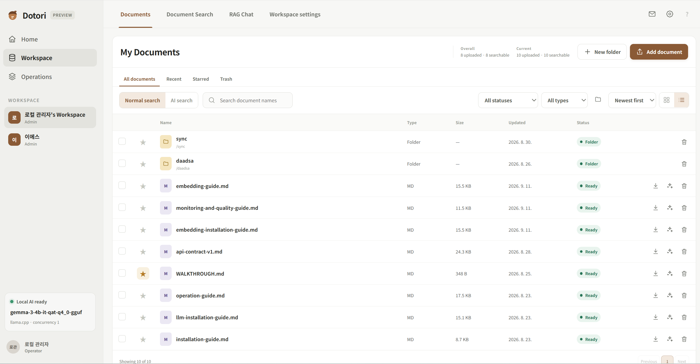

# Dotori Documents

Dotori is a lightweight, full-stack, self-hosted bridge between operator-owned files and AI. It prepares reusable document results for web access, search, built-in RAG and external read-only MCP/API consumers. Documents is the implemented module; separate Image, Audio and Video processing modules are future goals. Local AI remains supported alongside explicitly connected external endpoints.

  

For Korean documentation, see [README.ko.md](README.ko.md). For the full documentation set (installation, operations, monitoring, etc), start at [dotori-docs/](dotori-docs/README.md).

## Key Features

- Multiple accounts with secure separation of files and document features
- Folder and file management with authentication, trash, favorites, and recent files
- Analysis of PDF, HWP, DOCX, and other text-based document formats
- Natural-language document search
- Local RAG with document evidence; local inference does not send prompts to an external inference provider
- Guided installation and use of a local LLM selected for the server's hardware
- Three installation modes, from file management only to a complete local RAG stack
- Korean and English web interfaces, with support for external AI models
- Read-only MCP/API access to prepared results without requiring Dotori's RAG generation
- Optional OpenAI-compatible embedding and LLM endpoints; compatible contracts and actual endpoint configuration must be checked separately

> [!CAUTION]
> Local LLM/runtime settings are resolved from server hardware during installation or explicit model changes, with an assessed manual-selection path where needed. There is no LLM priority preset or per-user local model selection.
> External embedding or LLM endpoints may receive text; an external AI client reading results through MCP/API may also forward them according to that client's configuration.

## Installation Mode

The included installation assistant, `start.bat`, lets operators set up the server without writing code. See the [installation guide](dotori-docs/guides/install/installation-guide.md) for details.

The installer provides the following options:

1. Optional feature activation, including enabling or disabling natural-language search and RAG
2. Local LLM installation guidance
3. Server environment configuration guidance
4. Optional direct HTTPS access, configured separately from model setup

## Quick Start

### Requirements

- Docker Engine or Docker Desktop
- Python 3.x
- An NVIDIA driver and NVIDIA Container Toolkit when using the vLLM GPU runtime
- A Hugging Face token when the selected model requires authentication

Docker Desktop with the WSL2 backend is recommended on Windows.

## Project Status

Dotori is under active development. The current source provides the features described above and includes experimental functionality. Please report bugs and feature requests through an issue or by email.

## License

See [LICENSE](LICENSE).
