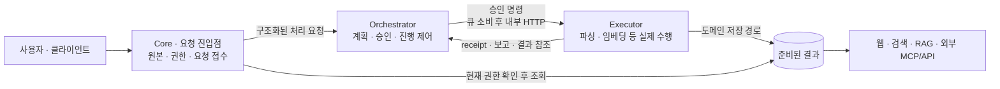
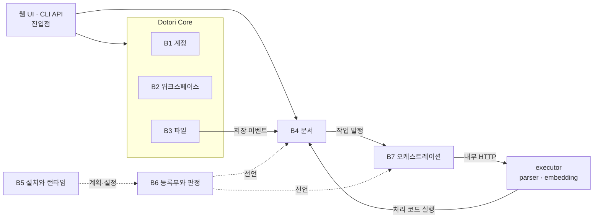

# 아키텍처

> 이전: [동작 방식](../overview/how-it-works.md) · 다음: [설계 원칙](./principles.md)

이 문서는 Dotori의 중심 구조인 **Core–Orchestrator–Executor의 책임 분리**와 그 위에 기능 모듈을 연결하는 방식을 설명합니다. Dotori는 공유 코드·DB를 사용하는 모듈러 모놀리스를 기반으로, 공통 작업 제어와 무거운 실행을 분리하고, 모듈 연결에 정적 등록과 Ports and Adapters의 계약 분리 원칙을 적용합니다. 현재 구현과 목표의 차이는 [차이와 과제](./gaps.md)에 모았습니다.

## 핵심 구조: 접점·실행 제어·실제 처리

Dotori는 운영자의 파일을 AI가 활용할 수 있는 결과로 미리 준비하는 제품입니다. 이를 위해 원본과 사용자 접점, 어떤 작업을 진행할지 결정하는 공통 제어, 실제 자원을 사용하는 처리를 나눕니다. RAG는 준비된 결과를 쓰는 소비자 중 하나이며, 로컬 AI와 외부 MCP/API 소비자가 같은 결과를 활용할 수 있습니다.

| 역할 | 맡는 책임 | 소유하지 않는 책임 |
| --- | --- | --- |
| Core·사용자 진입점 | 요청을 받고 원본·Workspace·권한·파일 수명과 결과 접근을 관리합니다 | 자료 유형별 분석과 모델 추론 알고리즘은 소유하지 않습니다 |
| Orchestrator | 요청을 실행 계획에 연결하고 승인 범위·명령·보고·다음 단계와 재시도를 제어합니다 | 문서 본문을 해석하거나 모델을 로딩하지 않습니다 |
| Executor | 고정된 입력의 실행 가능성을 검사하고 파싱·임베딩 등 실제 처리를 수행합니다 | 임의로 요청 범위를 확대하거나 새로운 계획을 승인하지 않습니다 |

이 표의 Core·사용자 진입점은 제품이 사용자와 만나는 접점 전체를 가리킵니다. 코드의 Core 도메인은 계정·Workspace·파일이며, 웹/API 진입점은 이를 호출하는 조합 계층입니다. Orchestrator도 공통 코드 계층과 queue consumer 프로세스를 구분합니다. 세 역할이 세 컨테이너·세 패키지와 일대일로 대응하는 것은 아닙니다.

다음은 운영자가 승인한 계획으로 실행하는 처리의 책임 흐름입니다. 업로드 직후 자동으로 이어지는 기존 사슬이나 모든 사용자 요청을 나타낸 도식은 아닙니다([처리 파이프라인](./runtime/pipeline.md)).

Executor도 원본을 읽고 문서 블록의 저장소 계층으로 결과를 저장할 수 있습니다. 모든 파일·DB 입출력이 Core 프로세스를 경유한다는 뜻이 아닙니다. Orchestrator는 결과의 의미를 문서 블록이 제공하는 어댑터(공통 제어와 문서 규칙을 잇는 변환 계층)에 묻고, 결과 참조와 실행 보고(receipt)를 사용해 승인된 다음 단계만 진행합니다. 용어는 [용어집](../reference/glossary.md)에 있습니다. 실제 내용·벡터를 공통 계획 원장으로 옮기지 않습니다.

### 역할과 기능 모듈은 서로 다른 축입니다

Core–Orchestrator–Executor는 **접수·제어·실행을 어떻게 나누는지**, Documents·향후 Images·Audio·Videos는 **어떤 자료의 규칙과 결과를 제공하는지**를 설명합니다.

Documents는 세 역할을 소유하는 또 하나의 코어가 아니라 공통 기반에 연결되는 기능 모듈입니다. 진입점에 문서 기능을 노출하고, 공통 제어에 원본·권한·결과 확인과 계획 어댑터를 연결하며, Executor에서 Documents의 parser·embedding handler를 실행합니다. 문서 결과 모델과 처리 알고리즘의 소유권은 Documents에 남습니다. 자세한 연결은 [문서 모듈](./blocks/documents.md#세-역할에-연결되는-문서-모듈)에 있습니다.

### 현재의 실행 범위

Orchestrator는 등록된 구조화 요청을 실행 계획과 명령으로 연결할 뿐, 자연어 입력을 해석하는 agent가 아닙니다. 검색·질의 이해·RAG는 app 요청 경로에서 실행하고([검색과 RAG](./runtime/query.md)), 파싱과 임베딩은 큐를 거쳐 executor가 실행합니다. 두 경로를 구분하는 방법과 아직 검증하지 않은 부분은 [오케스트레이션](./blocks/orchestration.md#현재의-한계)에 있습니다.

### 모듈 선택은 실행 비용을 선택하는 것입니다

선택 설치는 모듈, 역량, Provider의 선언에서 필요한 서비스를 정합니다. 문서 모듈을 고르지 않아도 코드와 DB 스키마는 남지만, 문서 작업은 거부되고 무거운 처리 서비스와 모델은 기동하지 않습니다. Core와 Orchestrator는 기본 구성에 남습니다. 새 모듈은 선언과 설치와 화면 조립 코드를 더해 추가하는 것이 목표이며, 등록된 모듈은 아직 문서 하나입니다. 프로세스와의 대응은 [배포](./deployment.md#세-역할과-실행-프로세스의-대응)에 있습니다.

## 읽는 순서

1. 이 문서의 핵심 구조: 세 역할과 기능 모듈의 관계를 먼저 읽습니다.
2. [설계 원칙](./principles.md#아키텍처-분류와-적용-범위): 구조를 선택한 이유와 패턴의 적용 범위를 읽습니다.
3. 이 문서의 블록 지도: 코드와 상태의 소유 단위를 봅니다.
4. 관심 있는 [블록 문서](#문서-지도), [처리 파이프라인](./runtime/pipeline.md), [배포](./deployment.md)
5. 코드를 바꾸기 전에 [블록 경계 규칙](./crosscutting/boundaries.md)

## 블록이란

블록은 코드를 나누는 단위입니다. 데이터를 쓸 수 있는 권한(상태의 소유)이 같은 코드를 한 블록으로 묶습니다. 계정은 계정 테이블을, 문서는 문서 테이블을 소유하고, 다른 블록은 그 데이터를 직접 바꾸지 않고 소유한 블록에 요청합니다. 번호(B1~B7)는 식별용이며 순서나 계층을 뜻하지 않습니다.

## 블록 지도

주 흐름만 표시했습니다. 실선은 호출과 전달, 점선은 선언과 설정의 참조이며 DB와 Redis는 생략했습니다.

상태는 DB 테이블, 호스트의 파일, 소스 코드의 선언 상수 중 하나로 저장됩니다. B6은 선언과 판정을, B7은 전달과 승인 계획·명령·보고의 저널을 소유합니다. 계획을 사용한 작업도 모든 업로드를 자동 전환한 것은 아니며, 기존 사슬과 명시 승인 경로를 구분합니다.

블록 사이의 참조에는 방향이 있습니다. 기반 블록인 B5, B6, B7은 기능 모듈인 B4를 참조하지 않습니다. 쓰기 권한과 참조 방향, 두 규칙은 테스트로 검사하며 [블록 경계 규칙](./crosscutting/boundaries.md)에서 다룹니다.

컨테이너는 실행·의존성·메모리 경계이고 블록과 일대일로 대응하지 않습니다. 컨테이너와 블록의 관계는 [배포](./deployment.md)를 봅니다.

## 블록 한눈에

| 블록 | 소유하는 상태 | 코드 위치 | 문서 |
| --- | --- | --- | --- |
| B1 계정 | 사용자, 인증 수단 (`accounts_*`) | `app/accounts/` | [Core](./blocks/core.md) |
| B2 워크스페이스 | 협업 단위, 멤버십 (`workspaces_*`) | `app/workspaces/` | [Core](./blocks/core.md) |
| B3 파일 | 폴더 트리, 업로드 원본, 작업 로그, 저장 용량 (`files_*`) | `app/files/` | [Core](./blocks/core.md) |
| B4 문서 | 파싱 결과, 청크, 임베딩, 작업 상태, 검색 품질 프로파일, 평가 데이터셋과 실행 (`documents_*`) | `app/documents/`, `app/search_engine/` | [문서](./blocks/documents.md) |
| B5 설치와 런타임 | 설치 계획, 런타임 설정 (호스트의 JSON 파일) | `app/llm_installation/`, `installation/`, `install.py`, `llm-runtime/` | [설치와 런타임](./blocks/installation.md) |
| B6 등록부와 판정 | 역량, 모듈, 작업 종류, 실행 역할의 선언 (코드 상수) | `app/capabilities/` | [등록부](./blocks/registry.md) |
| B7 오케스트레이션 | 계획 접수와 명령 발행 저널 (`PlanSubmission`, `PlanCommandDelivery`. `PlanSubmission`은 기존 테이블 이름 `documents_plansubmission`을 유지합니다) | `app/orchestration/`, `app/orchestration_state/` | [오케스트레이션](./blocks/orchestration.md) |

## 구성과 블록의 대응

[설계 원칙](./principles.md)이 소개하는 구성은 다음과 같이 블록으로 나타납니다. 블록은 상태를 소유하는 단위이므로 상태를 소유하지 않는 구성은 블록이 아닙니다.

| 설계 원칙의 구성 | 블록 | 세 역할 | 비고 |
| --- | --- | --- | --- |
| Kernel (Dotori Core) | B1 계정, B2 워크스페이스, B3 파일 | Core | [Core](./blocks/core.md) |
| Registry | B6 등록부와 판정 | 세 역할이 함께 읽는 선언 | [등록부](./blocks/registry.md) |
| 작업 전달 (Orchestrator) | B7 오케스트레이션 | Orchestrator | [오케스트레이션](./blocks/orchestration.md) |
| 기능 모듈 | B4 문서 | 세 역할에 연결되는 모듈 | [문서](./blocks/documents.md) |
| Installer | B5 설치와 런타임 | 세 역할 밖(설치 시점) | [설치와 런타임](./blocks/installation.md) |
| 구현 Adapter | 블록 아님 | Executor가 실행 | 구현 클래스는 B4에, 구현 이름의 선언은 B6에, 선택은 B5에 있습니다. [Provider](./crosscutting/provider.md) |
| 실행 프로세스 | 블록 아님 | Orchestrator와 Executor | 실행 코드는 B7과 B4에 있고, 프로세스는 [배포](./deployment.md)의 단위입니다 |

상태를 소유하지 않는 코드도 블록이 아닙니다. `app/config/`는 Django 설정, Celery 앱, URL 루트로 블록을 조립합니다. `web/`의 SPA는 웹 UI이고 `clients/`의 CLI와 동기화 클라이언트, MCP 어댑터는 외부 클라이언트이며, 모두 블록을 호출하는 진입점입니다. 블록 패키지 안의 뷰와 URL(`views`, `api_v1`)은 여러 블록을 호출하는 조합 계층이며 해당 블록의 도메인과 구분합니다. `scripts/`는 요청 경로에 놓이지 않는 운영용 일회성 도구입니다.

## 문서 지도

| 관점 | 문서 | 수준 |
| --- | --- | --- |
| 원칙 | [설계 원칙](./principles.md) | L2 |
| 구조 | [Core](./blocks/core.md), [등록부](./blocks/registry.md), [오케스트레이션](./blocks/orchestration.md), [문서](./blocks/documents.md), [설치와 런타임](./blocks/installation.md), [카탈로그](./blocks/catalog.md) | L2 |
| 런타임 | [처리 파이프라인](./runtime/pipeline.md), [검색과 RAG](./runtime/query.md) | L2 |
| 배포 | [배포](./deployment.md) | L2 |
| 횡단 | [Provider](./crosscutting/provider.md) | L2 |
| 횡단 | [블록 경계 규칙](./crosscutting/boundaries.md), [작업 상태와 정합성](./crosscutting/consistency.md), [기능 활성](./crosscutting/activation.md) | L3 |
| 방법 | [Provider 추가](./extending/add-provider.md), [문서 작성 규칙](./extending/writing-docs.md) | 방법 |
| 차이 | [차이와 과제](./gaps.md) | L3 |

수준 L2는 구조, L3는 규칙과 세부입니다.
