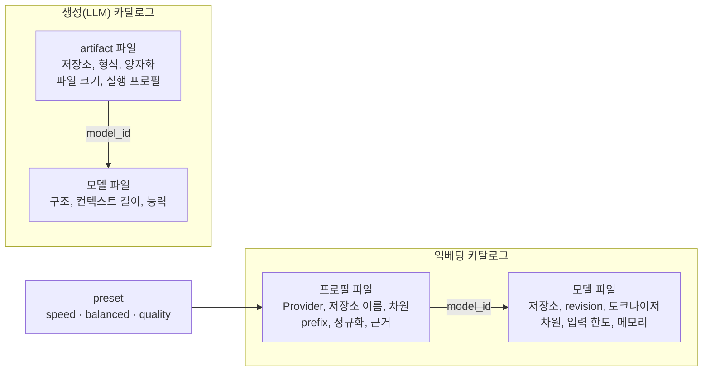

# 카탈로그

> 이전: [설치와 런타임](./installation.md) · 다음: [처리 파이프라인](../runtime/pipeline.md)

이 문서는 설치 시 선택할 수 있는 모델과 실행 설정의 목록이 어떤 구조로 선언되는지 다룹니다. [설계 원칙](../principles.md)이 소개하는 Installer가 읽는 선언이 그 대상입니다.

## 선언 파일인 이유

모델 목록은 코드 상수가 아니라 JSON 파일입니다. 모델 가중치를 제품 이미지에 넣지 않는다는 제약([모델 가중치는 제품 이미지와 분리합니다](../principles.md#모델-가중치는-제품-이미지와-분리합니다)) 때문에 이미지는 모델을 알지 못하고, 파일이 내려받을 저장소(`repo_id`)와 고정할 `revision`을 선언합니다. 그래서 모델을 더하는 일은 파일을 추가하는 일이고 코드를 바꾸지 않습니다.

## 모델과 실행 방법의 쌍

두 카탈로그 모두 파일이 둘로 나뉩니다. 모델의 정체성은 하나이고 그 모델을 실행하는 방법은 여럿일 수 있기 때문입니다.

같은 BGE-M3 모델에 `bgem3_hybrid` 프로필과 `sentence_transformers` 프로필을 따로 둘 수 있고, 같은 Qwen 모델에 양자화가 다른 artifact를 여럿 둘 수 있습니다.

## 두 카탈로그의 비대칭

| | 임베딩 | 생성 |
| --- | --- | --- |
| 짝을 이루는 것 | 모델과 프로필 | 모델과 artifact |
| 둘째 파일이 정하는 것 | 어떤 구현(Provider)으로 실행하는가 | 어떤 형식과 양자화로 배포하는가 |
| 선택을 받는 방식 | preset으로 의도(speed, balanced, quality)를 받습니다 | 서버 하드웨어 탐지만으로 모델과 서빙 설정을 정합니다 |
| 실행 대상 | 프로필의 Provider | 설치 시 하드웨어 탐지로 정해지는 llama.cpp 또는 vLLM |

생성 쪽에는 preset에 해당하는 선택지가 없습니다. 모델과 서빙 설정을 하드웨어에서 계산하기 때문입니다([설치와 런타임](./installation.md)).

## 카탈로그가 결정하지 않는 것

카탈로그는 선택할 수 있는 것의 목록이며 선택된 것이 아닙니다. 무엇이 활성인지는 설치 계획과 런타임 설정이 정하고([설치와 런타임](./installation.md)), 선언한 동작이 실제로 보장되는지는 검증 등급이 정합니다([검증 등급](../../reference/verification-grades.md)).

## 선언이 통과하는 검사

임베딩 카탈로그는 읽을 때 다음을 확인하고, 하나라도 어긋나면 읽기를 중단합니다.

- 모델 id와 프로필 id는 중복되지 않습니다. 프로필이 가리키는 모델이 존재합니다.
- 프로필의 차원이 모델의 차원과 같습니다. 차원을 줄이는 경우는 `sentence_transformers`의 `truncate_dim`이나 `openai_compatible`의 `send_dimensions`를 명시했을 때만 허용합니다.
- 프로필이 선언하는 기능은 `text.embed`뿐이고, 그 기능이 프로필의 Provider와 호환됩니다.
- 검증된 것으로 선언한 기능은 근거 파일(`evidence_ref`)이 모델과 프로필에 들어맞습니다. 확인되지 않았다고 선언한 기능(`declared_unverified`)은 근거를 요구하지 않습니다.
- `availability`가 `supported`인 프로필은 코드에 등록된 Provider 이름을 써야 하고, 저장소 이름이 가리키는 차원이 프로필의 차원과 같아야 합니다. `experimental`과 `unavailable`은 이 두 가지를 요구하지 않습니다.
- 모든 preset은 존재하는 `supported` 프로필을 가리킵니다.

Provider별로 선언할 수 있는 옵션의 범위는 [Provider](../crosscutting/provider.md#카탈로그와-프로필)가 다룹니다.

## preset이 한곳에 모인 이유

preset은 프로필마다 적지 않고 코드의 한 곳(`embedding_catalog/presets.py`)에 모읍니다. 어떤 모델이 speed, balanced, quality 요청에 답하는지는 모델의 속성이 아니라 제품의 라우팅 결정이기 때문입니다. 현재는 speed가 `harrier-270m`, balanced가 `bge-m3-hybrid`, quality가 `gte-qwen2-1.5b`입니다.

## 확장 경계

- **모델을 더하는 것**: 카탈로그 작업입니다. 모델 파일과 프로필(또는 artifact) 파일을 추가하며, 같은 Provider를 쓰는 한 코드와 이미지는 그대로입니다. 절차는 [임베딩 설치 가이드](../../guides/install/embedding-installation-guide.md)에 있습니다.
- **구현을 더하는 것**: 코드 변경과 이미지 다시 빌드가 필요합니다. 새 Provider는 등록부와 구현 레지스트리에 이름을 더해야 선언할 수 있습니다([Provider 추가](../extending/add-provider.md)).

다루지 않는 것: 파일의 필드 작성법은 [임베딩 설치 가이드](../../guides/install/embedding-installation-guide.md)가, 선언된 구현의 구조는 [Provider](../crosscutting/provider.md)가, 선택이 언제 적용되는지는 [설정 변경 적용](../../guides/operate/applying-changes.md)이 다룹니다.
