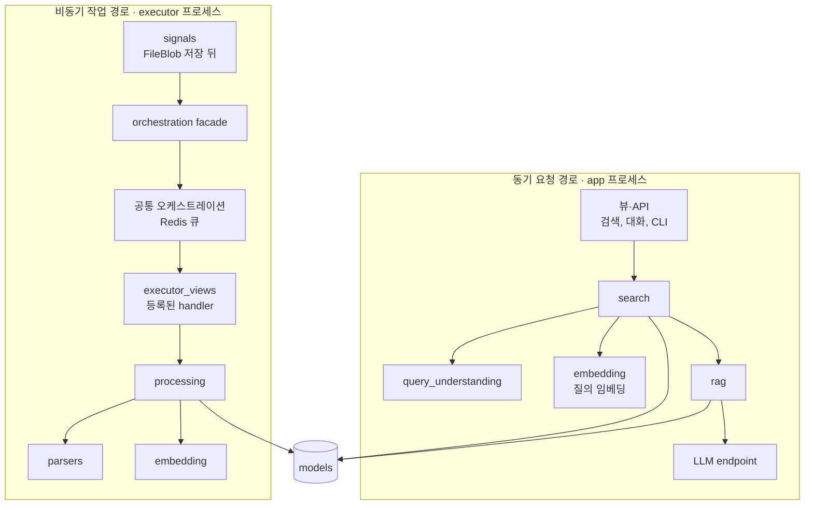

# 문서

> 이전: [오케스트레이션](./orchestration.md) · 다음: [설치와 런타임](./installation.md)

이 문서는 문서(B4)의 하위 구조를 자세히 다룹니다. 문서는 현재 등록된 유일한 기능 모듈이며, 유형별 처리 알고리즘(파싱, 임베딩, 검색, RAG)과 그 결과를 소유합니다. 원본과 결과의 경계는 [Core](./core.md)에서 설명합니다.

| 블록 | 소유하는 상태 | 코드 위치 |
| --- | --- | --- |
| B4 문서 | 파싱 결과, 청크, 임베딩, 작업 상태, 검색 품질 프로파일, 평가 데이터셋과 실행 (`documents_*`) | `app/documents/`, `app/search_engine/` |

## 세 역할에 연결되는 문서 모듈

Documents는 문서 알고리즘만 담은 라이브러리도, Core·Orchestrator·Executor를 소유하는 독립 서비스도 아닙니다. 문서를 접수하고 계획에 연결해 처리 결과를 제공하는 기능 모듈입니다. 공통 기반을 호출하는 adapter와 Executor에서 수행할 handler·Provider, 결과 모델을 함께 제공합니다.

- 접점에서는 파일의 권한과 원본 수명을 Core에 맡기고 문서 요청·상태·결과 조회를 조합합니다.
- 제어 경계에서는 Documents가 source·artifact·결과의 의미를 검증하고 명령과 보고로 변환합니다. 공통 Orchestrator가 승인 계획·발행·재전달·진행 원장을 소유합니다.
- 실행 경계에서는 parser/embedding Executor가 Documents의 처리 구현을 실행하며 도메인 repository로 결과와 receipt를 저장합니다. batch 모델 실행은 Executor가 담당합니다.

새 문서 형식이나 Provider의 알고리즘 변경은 이 모듈에 두고 공통 제어에 형식별 분기를 추가하지 않습니다. 새 모듈을 연결하는 정적 선언·설치·API/UI 조립은 추가할 수 있지만, Core가 문서 결과 모델을 직접 변경하거나 공통 Orchestrator가 Docling·Torch를 불러오는 구조로 되돌리지 않습니다.

모듈을 선택하지 않는 것은 현재 코드·schema 제거가 아니라 기능과 무거운 실행의 비활성화입니다. 공유 DB에서도 문서 결과의 소유권은 Documents에 남습니다. 전체 역할 지도는 [상위 아키텍처](../README.md#핵심-구조-접점실행-제어실제-처리)를 따릅니다.

## 하위 블록

동기 요청 경로와 비동기 작업 경로가 이 블록 안에서 갈라지며, 두 경로가 사용하는 외부 실행 프로세스도 서로 다릅니다. 문서가 처리되는 순서에 따른 하위 블록은 다음과 같습니다.

| 하위 블록 | 하는 일 |
| --- | --- |
| 처리 (`processing/`) | 업로드된 파일에 대해 파싱·임베딩 작업을 개시하고, 입력 경로를 해석하며, 중단된 작업을 복구합니다 |
| 파서 (`parsers/`) | 문서 형식별로 텍스트를 추출합니다 |
| 임베딩 (`embedding/`) | [Provider](../crosscutting/provider.md)를 고르고 벡터를 만들어 저장소와 인덱스에 넣습니다 |
| 질의 이해 (`query_understanding/`) | 자연어 질의를 구조화된 질의로 바꿉니다 |
| 검색 (`search/`) | 검색을 실행하고 리트리버와 품질 프로파일을 적용합니다 |
| RAG (`rag/`) | 프롬프트를 구성해 답변을 생성하고 스트리밍합니다 |

이들을 공통으로 뒷받침하는 하위 블록은 다음과 같습니다.

| 하위 블록 | 하는 일 |
| --- | --- |
| 문서 작업 facade (`orchestration.py`) | 문서 도메인 호출자의 호환 진입점입니다. 선언은 `capabilities`, 공통 발행·전송·재시도는 `app/orchestration/`에 위임합니다 |
| 작업 진입점 (`tasks.py`, `executor_views.py`) | 기존 task/HTTP 이름의 호환 경로입니다. 공통 HTTP 실행은 `orchestration.executor_views`, 문서 실행은 등록된 Documents handler가 담당합니다 |
| 서비스 (`services/`) | 런타임 설정 읽기, 상태와 지표, 수용 판정 위임, executor 전송을 맡습니다 |
| 모델 (`models/`) | 처리 결과를 저장하며 도메인 처리 상태의 기준입니다 |
| 검색 엔진 (`app/search_engine/`) | 검색 쿼리를 실행하는 엔진입니다. `documents` 밖의 패키지이며 참조하는 쪽은 B4뿐입니다 |

## 두 경로

문서 블록 안에서 요청은 두 갈래로 흐릅니다. 이 둘이 쓰는 외부 프로세스도 다릅니다.

- **동기 경로**는 검색과 RAG이며 app의 요청 처리 안에서 끝납니다. 질의 임베딩은 embedding executor에 직접 요청하고, 생성은 선택된 LLM endpoint를 비동기로 호출합니다([검색과 RAG](../runtime/query.md)).
- **비동기 경로**는 파일이 저장된 뒤의 파싱과 임베딩입니다. 업로드 시그널이 초기 작업을 발행하고, 이후는 공통 오케스트레이션이 executor로 전달합니다([처리 파이프라인](../runtime/pipeline.md)).

## 하위 블록 사이의 의존

대체로 아래에서 위로 쌓입니다. `models`와 `services`가 맨 아래에서 모두에게 쓰이고, 그 위에 `parsers`, `embedding`이 있으며, `processing`, `query_understanding`, `search`, `rag`가 이를 조합합니다.

이 방향을 거스르는 참조가 있습니다. 소스 import를 세어 보면 다음 관계가 양방향입니다.

| 관계 | 내용 |
| --- | --- |
| `processing` ↔ `embedding` | 처리가 임베딩 구현을 부르고, 임베딩의 저장과 범위 지정 실행이 처리의 파싱 지문, 배치 바인딩, 임베딩 계약, manifest 검증을 다시 참조합니다 |
| `search` ↔ `rag` | 검색의 품질 프로파일과 뷰가 RAG의 프롬프트 프로파일과 스트리밍을 쓰고, RAG가 검색의 프로파일과 벡터 검색 실행을 부릅니다 |
| `services` → `processing`, `parsers` | 맨 아래 계층이 위 계층의 일부를 참조합니다 |

`search_engine`은 `documents` 밖의 패키지입니다. `query_understanding`이 이를 사용하고, `search_engine`도 `documents`의 파서 설정을 참조해 문서 블록과 서로 순환합니다. 이 순환을 포함한 구조의 차이는 [차이와 과제](../gaps.md)에 모읍니다.

## 작업 진입점이 오케스트레이션과 만나는 곳

문서 블록은 공통 오케스트레이션과 세 곳에서 만납니다.

- **발행**: `signals.py`가 `FileBlob` 저장이 commit된 뒤 초기 작업을 발행합니다. 호출은 `orchestration.py`(문서 작업 facade)를 지나 공통 발행으로 이어집니다. 임베딩 계획을 명시적으로 접수하는 호출(`submit_embedding_plan`)도 이 facade에 있습니다.
- **실행**: 작업을 받는 HTTP 진입점은 공통 `orchestration.executor_views`입니다. 어떤 handler가 실행되는지는 등록부의 작업 선언(`processing/work_handlers.py`의 handler)이 정합니다.
- **호환 경로**: `tasks.py`의 Celery 작업 이름(`parse_document_with_docling`, `enqueue_embedding_tasks` 등)과 `executor_views.py`는 기존 호출자를 위해 이름을 유지하는 얇은 경계입니다. 소유는 공통 오케스트레이션에 있습니다.

## 처리 결과를 소유하는 모델

| 구분 | 모델 | 맡는 결과 |
| --- | --- | --- |
| 파싱 | `DocumentParseResult`, `DocumentChunk` | 파일에서 추출한 구조와 검색 단위의 조각 |
| 임베딩 | `EmbeddingGeneration`, `ChunkEmbedding`, `ChunkSegmentEmbedding`, `DocumentEmbeddingManifest` | 어떤 런타임 세대로 어떤 청크를 벡터화했는가와 승인된 대상 |
| 작업 | `ExecutorJobReceipt` | 실행 한 건의 식별과 결과 요약 |
| 검색과 RAG | `SearchJob`, `QueryUnderstandingLog`, `RAGJob`, `RAGConversation`, `RAGMessage` | 요청과 응답의 기록 |
| 품질 | `WorkspaceQualityProfileRevision`, `WorkspaceEvaluationDataset`, `WorkspaceQualityEvaluationRun` | 검색 품질 프로파일과 평가 |

전체 목록과 외래 키 관계는 [데이터 모델](../../reference/data-model.md)에 있습니다. 도메인 처리 상태의 기준은 이 모델들이며, 큐나 receipt가 아닙니다([작업 상태와 정합성](../crosscutting/consistency.md)).
