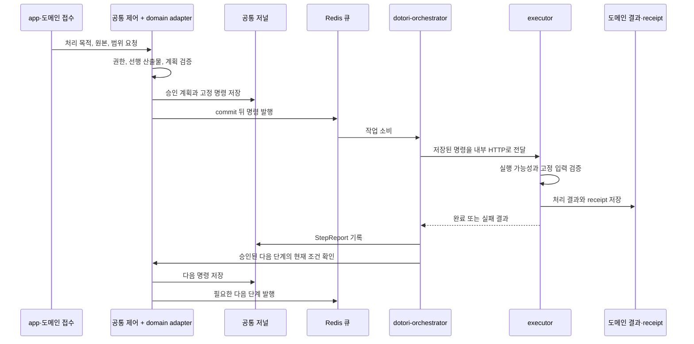

# 오케스트레이션

> 이전: [등록부](./registry.md) · 다음: [문서](./documents.md)

이 문서는 오케스트레이션(B7)을 자세히 다룹니다. 오케스트레이션은 어떤 작업을 어떤 순서로 실행하도록 승인했는지 기록하고, 그 작업을 executor에 전달하며, 결과에 따라 승인된 다음 단계를 진행하는 공통 제어 계층입니다. 문서를 파싱하거나 벡터를 만드는 알고리즘은 문서 블록과 executor가 소유하며, 이 계층은 Documents 모델이나 추론 라이브러리를 참조하지 않습니다.

코드 계층 `app/orchestration/`과 실행 서비스 `dotori-orchestrator`는 다릅니다. 공통 코드는 app의 접수 경로와 executor의 HTTP 진입점에서도 쓰입니다. `dotori-orchestrator`는 `parse`와 `embed` 큐를 소비하고 내부 HTTP로 executor에 작업을 전달하는 프로세스입니다. executor는 Redis 큐를 소비하지 않습니다.

| 블록 | 소유하는 상태 | 코드 위치 |
| --- | --- | --- |
| B7 오케스트레이션 | 계획 접수와 명령 발행 저널 (`PlanSubmission`, `PlanCommandDelivery`. `PlanSubmission`은 기존 테이블 이름 `documents_plansubmission`을 유지합니다) | `app/orchestration/`, `app/orchestration_state/` |

## 왜 문서 블록 밖에 두는가

Dotori가 하는 일은 파일을 AI와 클라이언트가 쓸 수 있는 산출물로 미리 준비하는 것이고, 문서는 그 첫 번째 자료 유형입니다. 작업 발행, HTTP 전달, 재시도, receipt 처리, 후속 발행 같은 공통 제어가 문서 처리 코드와 함께 있으면 다른 자료 유형은 문서 코드에 의존하거나 전달 로직을 복제해야 합니다. 그래서 두 책임을 나눕니다.

- 공통 계층은 승인된 계획, 작업 식별, 전달과 진행 상태를 관리합니다.
- 기능 모듈은 원본과 산출물의 의미, 도메인 검증, 실제 처리와 저장을 관리합니다.

이 나눔은 새 자료 유형의 알고리즘을 공통 계층에 넣는 것이 아니라, 공통 계약에 모듈을 연결할 수 있게 하는 것입니다. 공통 계층과 도메인 구현 사이에는 Ports and Adapters의 계약 분리를 적용합니다. 공통 계층은 handler, repository, plan adapter의 계약만 쓰고, 구현은 등록부가 선언한 것을 실행 경계에서 해석합니다. Django ORM까지 완전히 분리하지는 않으므로 순수 헥사고날 구조는 아닙니다. 구조의 분류는 [설계 원칙](../principles.md)을 따릅니다.

## 책임의 분담

| 구성 | 위치 | 주요 책임 |
| --- | --- | --- |
| 공통 제어 | `app/orchestration/` | 작업 봉투와 발행, 계획·명령·결과 계약, 접수와 전달, 재시도, 후속 진행을 맡습니다 |
| 공통 저장 | `app/orchestration_state/` | 계획 접수와 명령 전달 이력을 같은 DB에 저장합니다. 별도 서비스가 아닙니다 |
| 정적 등록부 | `app/capabilities/` | 작업 종류, 실행 역할, 큐와 adapter 연결을 선언합니다 |
| 문서 | `app/documents/` | 원본과 권한과 산출물 검증, 승인 목록(manifest), 처리 결과, receipt의 ORM 저장을 맡습니다 |
| 실행 프로세스 | parser와 embedding executor | 고정된 명령을 검증하고 파싱, 모델 추론, 배치 저장을 수행합니다 |

상태 이름은 다음과 같습니다.

- `PlanSubmission`은 접수된 계획과 진행·보고 기록을 보관하는 공통 저널입니다.
- `PlanCommandDelivery`는 단계별로 저장된 명령과 발행 기록입니다. 일부만 발행에 실패해도 같은 명령과 job 식별자를 다시 쓸 수 있는 근거가 됩니다.
- `ExecutorJobReceipt`는 한 작업 요청의 식별, 시도 횟수, 실행 상태, 완료 결과를 기록합니다. 식별과 수명주기 계약은 공통 계층이 소유하고, 현재의 ORM과 충돌 정책은 문서 블록이 구현합니다. 청크별 체크포인트가 아니며 도메인 결과 테이블을 대체하지도 않습니다.
- `StepReport`는 작업 결과를 계획의 단계 결과로 잇는 보고 계약입니다. 청크나 벡터가 아니라 상태와 산출물 참조를 담습니다.
- manifest는 문서 블록이 확정한 처리 대상 목록입니다. 재개 지점을 저장하지 않습니다.

계획 저널·receipt·도메인 산출물의 저장 위치, 갱신 방식과 전체 이력으로 보존하지 않는 범위는 [영속 저장의 범위](../crosscutting/consistency.md#영속-저장의-범위)를 따릅니다. `orchestration_state`는 이 중 공통 계획·전달 기록의 저장부이지 모든 실행 기록을 모으는 저장소가 아닙니다.

## 명시적 계획의 실행 흐름

보고를 먼저 확정하고 후속 명령을 발행합니다. executor가 제안한 후속 작업으로 승인된 계획을 넓힐 수는 없습니다. 완료 보고는 그때의 실행 결과를 기록할 뿐이어서, 다음 단계가 지금도 권한과 입력과 의존 산출물을 갖추었는지 확인하는 일을 대신하지 않습니다.

Orchestrator는 adapter가 내놓은 도메인 증거로 요청이 적절한지 판단합니다. 유효한 파싱 산출물이 있으면 재사용하고, 없으면 승인된 선행 파싱 단계를 거칩니다. executor는 전달받은 고정 입력으로 실행할 수 있는지만 검사하며, 새 원본을 고르거나 재파싱 단계를 임의로 더하지 않습니다.

현재 문서 블록의 연결은 문서 전체 또는 지정한 청크 집합을 대상으로 하고, 처리 의도로 `missing`(유효한 결과가 없는 대상만)과 `refresh`(선택한 대상을 다시)를 지원합니다. 모델 호출 크기, 내부 배치, DB 쓰기 묶음은 embedding executor가 정합니다. 기존 업로드의 parse → 임베딩 계획 → 배치 사슬은 이 경로와 별개로 유지됩니다([처리 파이프라인](../runtime/pipeline.md)). 검색과 RAG는 요청 경로에서 실행되므로 이 큐를 거치지 않습니다([검색과 RAG](../runtime/query.md)).

## 전달과 재시도

Orchestrator는 큐에서 꺼낸 작업을 executor에 내부 HTTP(Bearer 토큰)로 전달하고, 응답의 후속 작업을 검증해 발행합니다.

- 전달 전에 그 작업의 역량이 켜져 있고 작업 경로가 현재 배포에 등록되어 있는지 확인합니다. 아니면 작업을 실패로 닫고 재시도하지 않습니다.
- 일시적인 오류는 약간의 무작위 지연을 더해 다시 시도합니다. 작업마다 마감 시각(기본 30분)이 있고, 넘으면 재시도를 멈춘 채 receipt를 확인해 복구하도록 남깁니다.
- 응답의 후속 작업이 잘못되었거나 허용되지 않으면 실패로 닫습니다. 다시 시도할 수 있는 거부 사유만 재시도합니다.

## 동시 처리 제한

| 위치 | 제한 | 넘었을 때 |
| --- | --- | --- |
| Orchestrator | 큐마다 동시에 전달 중인 작업이 하나 | 슬롯이 차 있으면 기다리지 않고 재시도합니다 |
| executor | 동시에 처리하는 작업이 하나 | `503 EXECUTOR_BUSY`와 `Retry-After: 5`로 돌려보내고 Orchestrator가 재시도합니다 |

executor는 바쁠 때 대기열을 자기 안에 쌓지 않고 거절합니다. 대기는 Redis 큐에서만 일어나므로 어디서 밀리는지 한곳에서 볼 수 있습니다.

## 큐 깊이 관측

오케스트레이션은 큐에 쌓인 작업 수를 읽는 일만 제공하고, 그 수로 무엇을 할지는 도메인이 정합니다. 문서 블록의 파싱 작업은 embed 큐가 한도에 이르면(`DOCUMENT_AI_EMBED_QUEUE_BACKPRESSURE_LIMIT`) 파일을 열기 전에 잠시 미룹니다. Redis를 읽지 못하면 관측을 끄고 계속 진행하므로(fail-open) 점검 실패가 업로드를 멈추게 하지는 않습니다.

## 중복 전달과 receipt

브로커의 재전달이나 응답 유실 뒤의 재시도로 같은 작업이 두 번 전달될 수 있습니다. job 식별자를 키로 하는 receipt가 이를 한 번의 결과로 수렴시킵니다.

- 같은 job 식별자에 다른 작업 종류나 payload가 오면 충돌로 거부합니다.
- receipt가 실행 중이거나 성공했거나 재시도 불가로 실패했으면 다시 실행하지 않고 기록된 결과를 돌려줍니다.
- 같은 대상에 이미 다른 작업이 실행 중이면 새 작업은 실행하지 않습니다.
- 재시도할 수 있는 실패는 원래 시도와 같은 입력과 런타임일 때만 다시 시작합니다. 시도는 4번까지이고 넘으면 `RETRIES_EXHAUSTED`로 닫습니다.
- 오래된 시도는 더 새로운 receipt를 바꿀 수 없습니다. 소유권이 달라지면 `EXECUTION_OWNERSHIP_LOST`로 막습니다.

완료 receipt가 이미 있는 작업의 중복 전달이나 보고 실패는 저장된 결과를 조회해 다시 보고할 뿐, 추론과 저장을 반복하지 않습니다. 반면 미완료의 재시도 가능한 작업은 같은 승인 manifest 전체를 다시 실행할 수 있어서 앞서 성공한 배치를 다시 추론할 수 있습니다. 모든 장애에서 모델 실행의 exactly-once를 보장하지는 않습니다. 상태별 권위와 저장 규칙은 [작업 상태와 정합성](../crosscutting/consistency.md)이 다룹니다.

## 큐를 executor가 소비하지 않는 이유

Redis 큐를 소비하는 프로세스는 dotori-orchestrator 하나입니다. 이 이미지에는 AI와 Docling 의존성이 없어서 가볍고, 모델을 올리는 프로세스는 executor 쪽에 둡니다([배포](../deployment.md)). 큐 소비, 재시도, 후속 작업 발행이 한곳에 모이고 executor는 요청 하나를 처리하고 응답하는 서비스로 단순해집니다.

대가도 있습니다. 모든 작업이 내부 HTTP를 한 번 더 거치므로 전달 지연이 있고, executor가 바쁠 때는 Orchestrator가 재시도로 흡수해야 합니다. 계획·명령·보고를 기록하는 DB 접근과 검증 경계도 늘었습니다. 결과, receipt, 보고, 큐 발행이 서로 다른 시점에 확정될 수 있어 책임 구분이 중요합니다. 상시 서비스 수는 늘리지 않았지만 메모리, 지연, DB 부하를 같은 조건에서 비교한 측정은 아직 없습니다.

## 현재의 한계

- 실행 중에 멈춘 `running` 작업은 시간이 지났다는 이유만으로 인수하지 않습니다. 고아 작업의 자동 해제는 없습니다.
- 전체 workflow의 재개와 취소, 무제한 재시도는 지원하지 않습니다.
- 실행 중 복합 장애, 전체 서비스 롤백, 이전 메시지 형식과의 호환은 검증하지 않았습니다. 구현 순서와 남은 과제는 [차이와 과제](../gaps.md)에 모읍니다.
