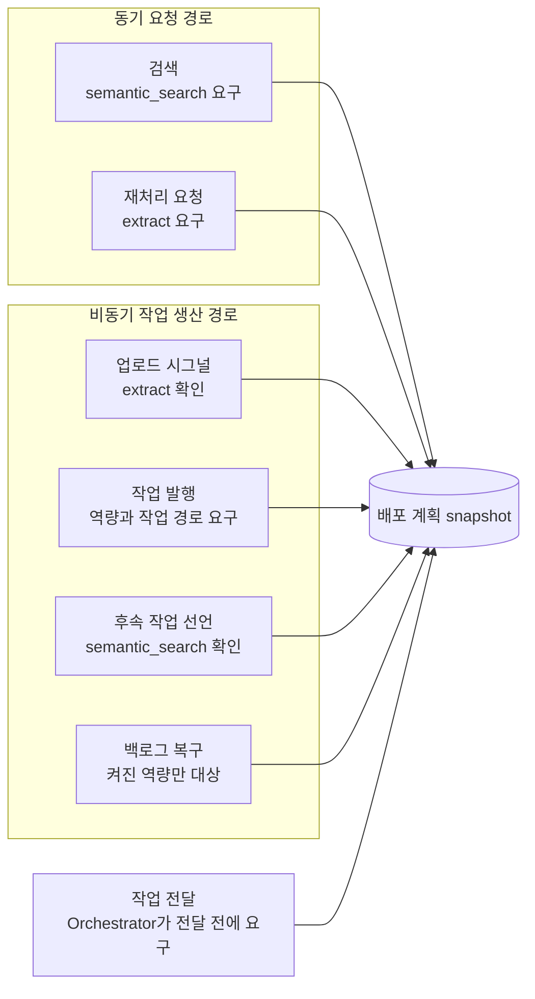

# 기능 활성

> 이전: [작업 상태와 정합성](./consistency.md) · 다음: [아키텍처](../README.md)

이 문서는 어떤 기능이 켜져 있는지를 누가 판정하고, 꺼진 기능을 어떻게 거부하는지 설명합니다.

- 설치 계획은 활성 기능, 실행 역할, 작업 경로의 공통 기준이며 모델과 실행 값은 runtime JSON에서 읽습니다. 내용의 중복 복제를 피합니다([설치와 런타임](../blocks/installation.md)).
- 선언되지 않은 기능, 실행 역할, 작업은 거부합니다. 구현의 존재와 해당 설치의 실행 가능성은 구분합니다([등록부](../blocks/registry.md)).
- 활성 여부는 서버가 판정합니다. 비활성 기능의 차단은 화면 숨김이 아니라 서버 진입점에서의 거부로 구현되어야 하며, 동기 요청 경로와 비동기 작업 생산 경로 모두 같은 판정을 거칩니다.
- 활성 기능의 변경은 설치 또는 명시적인 재구성에서 수행하며 요청 처리 중 계획을 수정하지 않습니다([서버는 운영자의 것입니다](../principles.md#서버는-운영자의-것입니다)). 변경이 프로세스에 적용되는 방법은 [설정 변경 적용](../../guides/operate/applying-changes.md)에서 다룹니다.

## 판정은 한곳에서 합니다

기능이 켜져 있는지는 [등록부](../blocks/registry.md#배포-계획-snapshot)가 읽는 배포 계획 snapshot 하나가 답합니다. 문서 블록은 그 판정을 다시 내보내(`documents/services/capability_admission.py`) 쓸 뿐 자기만의 판정을 갖지 않습니다. 판정을 묻는 방식은 두 가지입니다.

| 방식 | 계획을 읽지 못하면 | 쓰는 곳 |
| --- | --- | --- |
| `require_capability` | 예외를 던집니다. 거부 사유가 담깁니다 | 요청이나 작업을 거절해야 하는 진입점 |
| `capability_enabled` | 꺼진 것으로 봅니다 | 켜져 있을 때만 일을 더하는 분기. 예를 들어 파싱이 끝난 뒤 임베딩 후속 작업을 선언할지 정할 때 |

## 거부 사유

| 코드 | 의미 | 다시 시도 | HTTP 응답 |
| --- | --- | --- | --- |
| `CAPABILITY_CONFIG_INVALID` | 배포 계획을 읽지 못했거나 검증에 실패했습니다 | 아니오 | 503 |
| `CAPABILITY_NOT_INSTALLED` | 활성 배포에 그 역량이 설치되어 있지 않습니다 | 아니오 | 409 |
| `CAPABILITY_DISABLED` | 설치되어 있지만 이 서버에서 꺼져 있습니다 | 아니오 | 409 |
| `CAPABILITY_UNAVAILABLE` | 역량은 켜져 있지만 작업 경로가 현재 배포에 등록되어 있지 않습니다 | 예 | 503 |

503은 서버의 상태나 구성 문제이고, 409는 요청이 현재 서버 구성과 맞지 않는다는 뜻입니다. 다시 시도 열의 "예"는 작업 경로가 곧 등록될 수 있어 같은 작업을 재시도해도 된다는 표시입니다. 응답 열은 문서와 검색 API 기준입니다.

## 같은 판정을 공유하는 지점

- **요청 경로**: 검색은 semantic search를, 파일 재처리 요청은 extract를 요구하고, 거부 사유를 위 표의 HTTP 응답으로 돌려줍니다.
- **작업 생산 경로**: 업로드 시그널은 extract가 꺼져 있으면 오류 없이 작업을 만들지 않고 넘어갑니다. 입력 종류를 알 수 없거나 발행 시점의 판정에서 거부되면 거부 사유를 기록하고 닫습니다. 모든 작업 발행은 역량과 작업 경로를 함께 요구합니다.
- **전달 경로**: Orchestrator는 작업을 executor에 전달하기 직전에도 같은 판정을 거칩니다. 큐에 들어간 뒤에 기능이 꺼졌어도 실행되지 않습니다([오케스트레이션](../blocks/orchestration.md#전달과-재시도)).
- **복구**: 백로그 복구는 켜진 역량의 작업만 다시 만듭니다.

기능 비활성화는 작업과 모델 서비스를 멈추는 것이며 코드나 DB 스키마를 지우지 않습니다. 켜짐 여부는 요청마다 계획을 다시 읽지 않고 프로세스가 가진 snapshot에서 읽으므로, 계획이 바뀌면 서비스를 다시 시작해야 반영됩니다.

다루지 않는 것: 재구성의 목표 절차는 [차이와 과제](../gaps.md)가 다룹니다.
