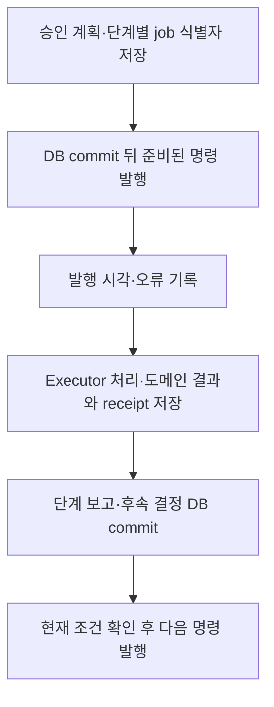

# 작업 상태와 정합성

> 이전: [블록 경계 규칙](./boundaries.md) · 다음: [기능 활성](./activation.md)

이 문서는 비동기 작업의 상태를 어떻게 기록하고, 중복 전달과 늦은 완료를 어떻게 다루는지 설명합니다.

- 상태의 기준은 DB에 둡니다. receipt는 HTTP redelivery의 identity와 terminal state를 기록하고 도메인 처리 상태는 복구의 기준입니다. broker 유실 시 재발행 가능한 처리 의도가 필요합니다([처리 파이프라인](../runtime/pipeline.md)).
- 중복 전달을 전제하고 같은 job의 재전달이 같은 결과로 수렴하도록 합니다. 현재 receipt는 같은 work kind와 target key의 running 작업 중복을 제한합니다. 서로 겹치는 배치의 청크 소유권은 도메인 claim에서 별도로 보장해야 합니다([블록 경계 규칙](./boundaries.md)).
- 결과 활성화 전에 source, runtime, 기한을 재검증하고 최신 상태를 덮어쓰지 않습니다([차이와 과제](../gaps.md)).
- schema와 설정 형식 변경은 신규 설치와 기존 설치의 이전 경로를 구분해 검증합니다([배포](../deployment.md)).

## 상태의 권위

같은 작업에 대해 기록이 여럿 있으므로, 무엇이 무엇의 기준인지 나눠 둡니다.

| 기록 | 기준이 되는 것 | 쓰임 |
| --- | --- | --- |
| 도메인 처리 상태 (`DocumentParseResult`, `DocumentChunk`, `ChunkEmbedding`의 상태) | 문서가 처리되었는가 | 복구가 대상을 고르는 기준입니다 |
| receipt (`ExecutorJobReceipt`) | 이 job의 식별자와 마지막 결과 | 중복 전달을 막고 완료 결과를 다시 보고하는 근거입니다 |
| 계획 저널 (`PlanSubmission`, `PlanCommandDelivery`) | 무엇을 승인했고 어디까지 발행했는가 | 명시적 계획에서 같은 명령을 다시 발행하는 근거입니다 |
| Redis 큐 | 없음 | 전달 수단일 뿐이며 유실될 수 있어서 상태의 기준이 아닙니다 |

receipt는 문서 내용이나 벡터를 담지 않습니다. 처리가 되었는지 알려면 도메인 상태를 보고, 이 job이 이미 끝났는지 알려면 receipt를 봅니다.

## 영속 저장의 범위

`orchestration_state`는 공통 orchestration의 DB 저장부입니다. `orchestration`이 접수·검증·발행·보고 로직을 수행하고, `orchestration_state`는 Django 모델과 migration을 제공합니다. 별도 서비스나 DB가 아니며 모든 실행 기록을 이곳에 모으지도 않습니다. 구현은 `app/orchestration_state/models.py`와 `app/orchestration/submissions.py`에 있습니다.

| 저장 대상 | 저장 위치 | 주요 내용 |
| --- | --- | --- |
| 승인 계획과 보고 | `orchestration_state.PlanSubmission` | 요청·계획·최초 job 식별자, Workspace·요청자·원본 참조, 계획 정의, 단계별 보고와 후속 제안·결정 기록을 저장합니다 |
| 단계별 명령 전달 | `orchestration_state.PlanCommandDelivery` | 계획·step·고정 job 식별자, 발행 시각과 오류를 저장합니다 |
| 실제 실행 기록 | 현재 Documents의 `ExecutorJobReceipt` | job 식별자와 입력 지문, 원본·runtime 스냅숏, 현재 attempt·실행 상태, 결과 메타데이터·오류·재시도 가능 여부를 저장합니다 |
| 실제 처리 대상과 산출물 | Documents 등 소유 도메인의 모델·저장소 | manifest, 파싱 결과, 청크와 벡터를 저장합니다. 공통 저널에 본문·벡터를 복제하지 않습니다 |

`PlanCommandDelivery` 자체에 실행 payload 전체가 들어가는 것은 아닙니다. 계획 정의와 필요한 경우 `PlanSubmission.control`의 확정 명령 기록, 도메인 manifest를 함께 사용해 동일한 실행 입력을 복원합니다. `StepReport`는 독립 테이블이 아니라 `PlanSubmission.reports`의 step별 보고로 저장하며, 상태와 산출물 참조를 담습니다.

발행 기록은 실행 완료의 증거가 아닙니다. receipt의 과거 성공도 결과가 지금 유효하다는 뜻은 아닙니다. 다음 단계나 검색에서 결과를 사용할 때에는 현재 권한·원본·의존 산출물 조건을 별도로 확인합니다.

### 저장과 발행의 순서

아래는 명시적 승인 계획의 흐름입니다. 기존 업로드 사슬이나 요청 경로의 모든 작업이 이 저널을 사용하는 것은 아닙니다.

후속 발행 전에 보고를 확정하므로, 다음 명령 발행에 실패해도 부모 실행의 결과를 재보고하고 진행을 이어갈 근거가 남습니다. 결과와 terminal receipt의 저장 경계는 executor와 도메인 구현이 담당합니다. 전체 흐름을 하나의 DB transaction으로 묶지는 않습니다.

DB와 Redis의 발행은 원자적이지 않습니다. 브로커가 메시지를 받았지만 DB의 발행 시각 저장이 실패하면 재발행될 수 있습니다. 고정 job 식별자와 receipt로 중복 전달을 제어하며, 발행 기록만으로 모델 실행의 exactly-once를 보장하지 않습니다. 저널이 있다는 이유만으로 자동 복구 스케줄러가 제공되는 것도 아닙니다.

### 전체 이벤트 이력으로 보존하지 않는 것

현재 저장 구조는 복구와 중복 방지에 필요한 저널이며, 모든 사건을 별도 행으로 누적하는 감사 로그나 이벤트 소싱 저장소는 아닙니다.

- `reports`는 step별 값을 갱신합니다. 중복 보고를 수신할 때마다 독립적인 수신 이력을 추가하지 않습니다. 성공 보고가 실패로 되돌아가는 것은 막습니다.
- `proposals`와 `control`은 후속 제안과 결정·확정 명령 등을 보관하지만, 모든 변경 전후 값을 시간순으로 보존하지 않습니다.
- `PlanCommandDelivery`는 계획·step별 하나의 행을 사용합니다. 발행 시각과 오류는 갱신되며, 모든 전송 시도를 별도 행으로 누적하지 않습니다. 성공한 발행은 이전 오류를 비웁니다.
- receipt는 job별 하나의 행에서 attempt와 실행 상태 등을 갱신합니다. 각 attempt의 전체 이력이나 청크별 실행 체크포인트를 별도 보존하지 않습니다.
- 일반 로그, 큐 메시지와 관측 정보는 계획 저널과 별개입니다. 실행 제어의 상태 기준이나 완전한 감사 이력을 대신하지 않습니다.

따라서 현재 레코드만으로 모든 시점의 상태를 재현하거나 과거 오류·보고 수신 횟수를 복원할 수는 없습니다. 기록의 무기한 보존도 보장하지 않습니다. 예를 들어 계획은 Workspace·요청자 삭제에 따른 연쇄 삭제 대상이며, 그 계획의 명령 전달 행도 함께 삭제됩니다. Agent 메모리나 workflow checkpoint의 보존·재개 정책을 구현한 것으로 해석하지 않습니다.

## 단계별 실패와 복구

| 실패 | 일어나는 일 | 복구 |
| --- | --- | --- |
| 발행 실패 (브로커 장애) | 업로드는 이미 끝났고 파일 원본은 저장되었으나 파싱 결과 행이 없습니다 | 이 상태가 복구의 입력입니다. 업로드를 실패로 되돌리지 않습니다 |
| 응답 유실 | 작업은 끝났는데 Orchestrator가 결과를 받지 못해 같은 작업이 다시 전달됩니다 | 완료 receipt가 있으면 저장된 결과를 조회해 다시 보고하고 추론을 반복하지 않습니다 |
| 늦은 완료 | 실행 중에 입력이나 런타임이 바뀌었거나 마감이 지났습니다 | 저장 직전 검증에서 중단하고 최신 상태를 덮어쓰지 않습니다 |
| executor가 바쁨 | 503으로 거절됩니다 | Orchestrator가 재시도합니다 ([오케스트레이션](../blocks/orchestration.md#전달과-재시도)) |
| 실행 중에 멈춤 | receipt가 `running`으로 남습니다 | 시간이 지났다는 이유만으로 인수하지 않습니다 |

### 저장 직전 검증

executor는 결과를 쓰기 직전에 `validate_execution`을 거칩니다. 다음 중 하나라도 어긋나면 `StaleExecution`으로 중단합니다.

- 마감 시각이 지났습니다.
- 명시적 계획의 명령이면 계획의 승인이 여전히 유효하지 않습니다.
- 작업을 시작할 때 잡아 둔 원본 스냅숏이나 런타임 스냅숏이 지금과 다릅니다.

이 검증은 파싱 결과와 임베딩을 쓰는 지점마다 있습니다. 또한 오래된 시도가 더 새로운 receipt를 바꾸지 못하도록 시도마다 소유권을 확인합니다([오케스트레이션](../blocks/orchestration.md#중복-전달과-receipt)).

### 복구

복구는 `repair_document_pipeline` 관리 명령으로 수동으로 실행합니다. 저장소에는 이를 주기적으로 실행하는 설정이 없습니다.

- 파싱 복구는 휴지통에 없고 AI 처리가 켜진 파일 가운데, 파싱 결과가 없거나 `PENDING`·`PROCESSING`·`FAILED` 상태로 정해진 시간(`DOCUMENT_AI_RECOVERY_STALE_MINUTES`) 넘게 머문 것을 고릅니다. 완료되었어도 청크 수가 어긋난 결과는 다시 처리합니다.
- 임베딩 복구는 파싱이 끝난 문서의 청크 가운데 같은 조건으로 머물렀고 완료된 임베딩이 없는 것을 고릅니다.
- 한 번의 실행에서 다룰 건수와 대상당 시도 횟수(`DOCUMENT_AI_MAX_RECOVERY_ATTEMPTS`)에 상한이 있고, 넘은 대상은 영구히 제외됩니다. 이 값들은 [설정 항목](../../reference/configuration.md#파이프라인-복구)에 있습니다.
- 꺼진 역량의 작업은 만들지 않고([기능 활성](./activation.md)), 이미 실행 중인 노드와 명시적 계획이 진행 중인 노드는 건너뜁니다. Redis에 대상별 잠금을 걸어 같은 대상이 중복 발행되는 것을 줄이며, Redis를 쓸 수 없으면 잠금 없이 진행합니다.

## 원본 교체와 삭제

원본(`Node`, `FileBlob`)이 삭제되면 그에 딸린 파싱 결과와 청크도 함께 지워집니다(외래 키의 연쇄 삭제). 그 시점에 진행 중인 작업은 저장 직전 검증에서 입력이 달라진 것을 발견하면 중단합니다. 다만 삭제 직전에 이미 쓰기가 시작된 경우를 포함해, 원본 삭제가 진행 중인 작업에 미치는 모든 경우를 하나하나 확인하지는 않았습니다. 휴지통으로 옮겨진 파일은 복구 대상에서 제외됩니다.

다루지 않는 것: 파이프라인의 단계 구조는 [처리 파이프라인](../runtime/pipeline.md)이 다룹니다.
