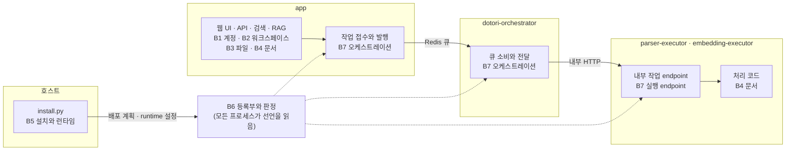
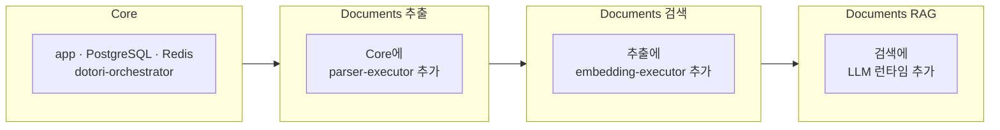

# 배포

> 이전: [검색과 RAG](./runtime/query.md) · 다음: [블록 경계 규칙](./crosscutting/boundaries.md)

이 문서는 Dotori가 어떤 프로세스와 이미지로 실행되는지, 설치 구성에 따라 무엇이 켜지는지 설명합니다. 컨테이너는 실행·의존성·메모리 경계이고 기능 모듈과 일대일로 대응하지 않습니다.

## 세 역할과 실행 프로세스의 대응

[Core–Orchestrator–Executor](./README.md#핵심-구조-접점실행-제어실제-처리)는 책임 구분이며 배포를 세 컨테이너로 제한하는 규칙이 아닙니다. app은 Core·진입점·동기 문서 소비와 공통 접수 코드를 함께 실행합니다. dotori-orchestrator는 큐 소비·전달을, parser/embedding Executor는 내부 HTTP 진입점과 Documents의 실제 처리 코드를 실행합니다. 선택한 LLM endpoint는 별도 요청 경로의 추론 실행 대상이며 문서 큐 소비자가 아닙니다.

공통 orchestration 코드는 접수하는 app, 소비자 프로세스, Executor HTTP 경계에서도 사용합니다. 반대로 Documents 코드가 이미지에 포함됐다는 사실은 그 프로세스가 모든 문서 기능·모델을 실행한다는 뜻이 아닙니다. 무거운 의존성과 로컬 embedding 가중치는 전용 실행 이미지·모델 프로세스로 격리합니다.

공유 코드·DB는 독립 배포 비용을 줄이는 대신 schema와 공통 backend 변경 때 관련 프로세스의 버전을 함께 맞춰야 합니다. 모듈 비활성화와 물리적 코드·테이블 제거를 구분하며, 선택 설치와 일반 Compose 시작의 범위도 따로 확인합니다.

## 프로세스와 이미지

| 구성요소 | 하는 일 | 이미지와 의존성 |
| --- | --- | --- |
| app | 웹 UI와 API를 제공하고 검색과 RAG를 요청 경로에서 실행합니다 | AI와 Docling이 없는 경량 web 이미지이며 Vite 빌드 결과를 포함합니다. DB와 Redis, 선택한 endpoint를 씁니다 |
| dotori-orchestrator | parse와 embed 큐를 소비해 executor에 HTTP로 전달합니다 | AI와 Docling이 없는 backend 이미지입니다. DB와 Redis, 등록된 executor를 씁니다 |
| parser-executor | 문서 파싱 작업을 실행합니다 | Docling을 포함한 parser 전용 이미지(`dotori-parser`)이며 원본과 DB에 접근합니다 |
| embedding-executor | 문서와 질의를 임베딩합니다 | AI 의존성을 포함한 embedding 전용 이미지(`dotori-embedding`)입니다. 로컬 모델을 직접 소유하거나 외부 Provider를 호출하며 DB에 접근합니다 |
| 선택한 LLM runtime | 답변을 생성합니다 | 로컬 또는 외부 대상입니다. 쓰지 않는 로컬 runtime은 중지합니다 |
| PostgreSQL과 Redis | PostgreSQL은 도메인 상태를, Redis는 작업 대기열과, RAG 슬롯·복구 잠금·취소 신호 같은 짧은 조율을 맡습니다 | 모든 프로세스가 공유하는 DB와 broker입니다 |

현재 app과 orchestrator의 Compose 직접 시작 의존은 DB·Redis이며 executor health에 직접 묶이지 않습니다. 설치 계획의 서비스 선택과 기본 `docker compose up --build`의 시작 범위는 구분합니다. 계획 기반 설치에서 선택하지 않은 서비스가 실행되지 않는지 검증해야 합니다.

## 프로세스와 블록

컨테이너와 블록은 일대일이 아닙니다. 같은 코드 베이스에서 프로세스마다 켜는 진입점이 달라서, 각 프로세스는 아래 블록을 중심으로 동작합니다.

app은 사용자 요청을 받는 유일한 프로세스이며 Core와 문서 기능을 모두 씁니다. dotori-orchestrator는 큐를 소비해 전달하고 후속 작업을 발행하는 일만 하므로 문서 처리 코드와 모델을 쓰지 않습니다. executor는 사용자용 경로 없이 내부 작업 endpoint만 열고, 전달받은 작업을 문서 블록의 처리 코드로 실행합니다. 등록부는 상태가 없는 선언이라 어느 프로세스에서나 읽힙니다.

## 설치 구성

설치 모드와의 대응은 다음과 같습니다. 기본 모드는 Core, Hybrid/Search AI 모드는 Documents 검색, Full 로컬 AI RAG 모드는 Documents RAG입니다. 추출만 켜는 구성은 설치기 내부 모드(`extract`)에 있지만 설치 가이드의 모드 표에는 나오지 않습니다.

현재 설치 코드의 Core 서비스에는 DB·Redis·app·orchestrator가 포함됩니다. 기능 비활성화는 우선 작업과 모델 서비스의 중지를 뜻하며 Python 코드와 DB schema의 물리적 제거까지 요구하지 않습니다. 이미지 등 모듈을 추가한 목표 구성과 구성별 자원 사용의 검증 기준은 [차이와 과제](./gaps.md)에서 다룹니다.

## 격리와 보호

- 웹과 오케스트레이터 이미지에 AI·Docling 의존성을 포함하지 않습니다. 모델 추론은 전용 프로세스에서 수행합니다([Lightweight](./principles.md#lightweight)).
- 웹과 오케스트레이터는 로컬 embedding 모델을 로드하지 않습니다. 모델 소유 프로세스를 늘려 같은 가중치를 중복 로드하지 않습니다([중복 로드 방지](./principles.md#로컬-모델을-중복해서-올리지-않습니다)).
- 내부 실행 표면은 시스템 외부로 노출되지 않습니다. executor는 호스트 포트를 발행하지 않고 내부 네트워크에서만 접근할 수 있으며 내부 작업 endpoint는 토큰 인증을 요구합니다. 사용자용 접근은 공개 API에서 권한을 확인합니다([인터페이스](../reference/interfaces.md)).
