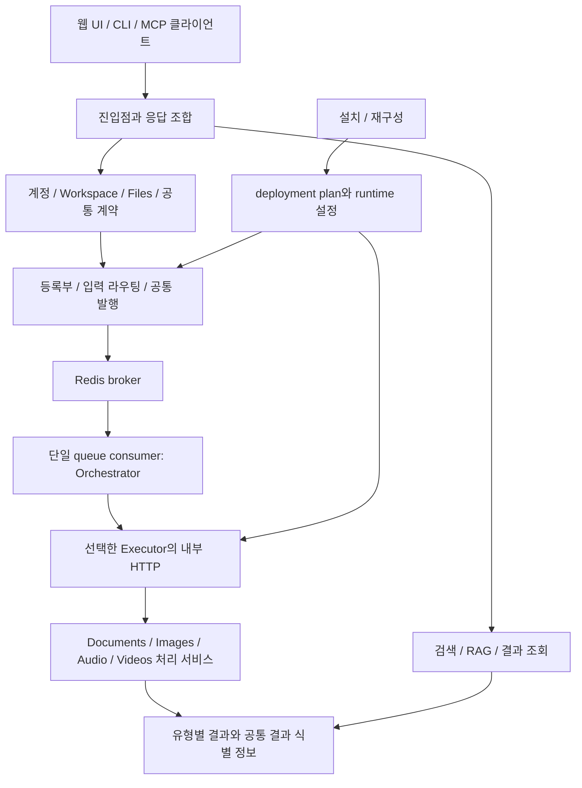
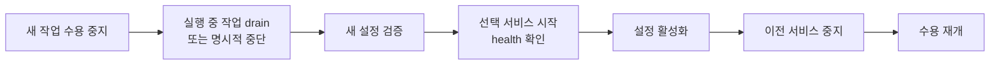

# 차이와 과제

> 이전: [아키텍처](./README.md)

이 문서는 현재 구현과 목표 구조의 차이, 그 차이를 메우기 위해 검증해야 할 계약, 구현 순서를 기록합니다. 코드 관찰은 작업 트리 기준이며 컨테이너 실행이나 성능 측정 결과를 뜻하지 않습니다. 구현 여부가 다른 항목은 목표 구조와 구분해서 적습니다.

## 현재 코드와 목표의 차이

| 관찰한 코드 | 현재 의미 | 설계에 미치는 영향 |
| --- | --- | --- |
| `app/capabilities/work_dispatch.py` | 공통 구현이 `app/orchestration/`으로 옮겨진 뒤 남은 호환 재수출 파일입니다. 쓰는 곳은 테스트 2개뿐입니다 | B6이 B7을 참조하는 유일한 지점이라 B6과 B7 사이의 순환을 만듭니다. 제거하면 순환이 사라지고, B6이 B7을 참조하지 못하게 하는 검사를 추가할 수 있습니다 |
| `app/documents/orchestration.py` | 공통 발행·backpressure는 orchestration에 위임하고 Documents enqueue·호환 enum/route를 유지합니다 | 공통 제어 이관은 완료됐습니다. 남은 이름 중복은 호환 정책을 확인한 뒤 정리하며 전달 계층을 다시 구현하지 않습니다 |
| `app/documents/signals.py` | FileBlob commit 뒤 공통 input intake를 호출하며 실패한 발행의 committed blob은 도메인 recovery 입력으로 남습니다 | 공통 초기 라우팅 경로는 존재합니다. hook과 현재 publisher는 Documents에 있으므로 다른 모듈 등록만으로 모든 업로드를 연결하는 구조까지 완료된 것은 아닙니다 |
| `app/capabilities/input_resolver.py` | 이미지 확장자를 포함한 입력을 모두 `document`로 분류합니다 | Images를 추가하기 전에 입력의 자료 유형과 처리 목적을 구분해야 합니다 |
| `app/files/models.py::Node.get_ai_status` | 문서의 활성 판정과 임베딩 runtime을 함수 안에서 import해 직접 해석합니다. Core 도메인 코드가 B4를 참조하는 곳은 측정 시점에 이것뿐이었습니다 | 도메인 파일 모델에서 문서 상태 조합을 제거하고, 조회 서비스에서 등록된 결과 adapter를 통해 조합합니다 |
| `app/documents/services/result_access.py`, `result_envelope.py` | 권한 확인, source revision과 checksum, stale 표시를 가진 문서 결과 접근이 존재합니다 | 공통 계약의 출발점은 있지만 실제 조회는 문서 테이블과 ID prefix에 고정되어 있습니다 |
| `app/documents/parsers/docling_parser.py`, `processing/parsing.py` | semantic search 활성 여부에 따라 chunker가 달라지고, 저장 경로는 청크 중심입니다 | 추출 산출물과 모델별 검색 산출물의 수명이 아직 함께 움직입니다. backend metadata의 구조화 문서 전체를 보존하는 경로는 이 저장 함수에서 확인되지 않습니다 |
| `app/documents/models/operations.py` | receipt의 공통 identity/lifecycle은 orchestration이, 현재 ORM·충돌 정책은 Documents repository가 소유합니다 | 두 번째 모듈의 repository와 domain 결과 계약을 검증해야 합니다. 모든 결과를 공통 테이블로 모으거나 청크별 checkpoint를 추가하는 과제는 아닙니다 |
| `app/orchestration_state/models.py` | `PlanSubmission`의 물리 테이블 이름이 기존 `documents_plansubmission`입니다 | 테이블 접두사로 소유 블록을 추정하면 B4로 오인합니다. 이름 변경은 데이터 이전을 동반하므로 소유 표에 명시해 둡니다 |
| `app/llm_installation/rag_runtime_config.py` | 요청 경로에서도 실제로 읽는 runtime 설정 모듈입니다 | B5 전체를 "설치 시점에만 사용, 요청 경로에 놓이지 않음"으로 설명하면 현재 구현과 다릅니다 |
| `installation/deployment.py`, `docker-compose.yml` | 설치 계획의 서비스 선택이 존재하고 app과 orchestrator의 직접 의존은 DB·Redis입니다. 기본 Compose에는 두 executor도 정의되어 있습니다 | 계획을 사용하는 시작 절차와 일반 Compose 시작의 의미를 구분해야 합니다 |
| `app/config/settings.py` | Documents가 Django 앱에 항상 등록됩니다 | 기능 비활성화와 코드·스키마 제거는 현재 같은 동작이 아닙니다 |
| `app/tests/ops/test_block_boundaries.py` | installer의 Documents import 금지, workspace view의 명시적 Documents import, 등록부와 오케스트레이션의 Documents·설치 코드 비참조, 다른 블록 모델에 대한 manager 쓰기 금지를 검사합니다 | 인스턴스 `save()`와 원시 SQL 쓰기, Core 도메인의 B4 참조는 검사하지 않습니다. Kernel 독립성은 아직 증명하지 않습니다 |
| `app/search_engine/` | `documents.parsers.text_utils`를 참조하고, `documents.query_understanding`이 다시 이 패키지를 호출합니다 | 독립된 블록이 아니며 B4와 순환 관계에 있습니다 |
| `app/files/services/storage.py::delete_file` | transaction 안에서 파일을 먼저 삭제합니다 | DB rollback으로 파일을 복구하지 못합니다. 이 경로와 원본 변경 중 늦은 완료는 별도 실패 검증이 필요합니다 |
| `app/orchestration/`, `app/orchestration_state/` | 승인된 정적 다단계 계획·manifest 명령·작업 단위 receipt·완료 보고 복구와 기본 Documents 연결이 구현되어 있습니다 | legacy 업로드와 명시 계획 경로는 별개입니다. 실행 중 복합 장애·동일 조건 비용·전체 legacy rollback·고아 running 해제는 별도 미완료이며 동적 agent/LangGraph는 미구현입니다 |

### 소유권 규칙과 구현의 차이

- `WorkspaceQualityProfileRevision`과 평가 데이터셋·실행은 `documents.models.evaluation`에 있고 변경 서비스도 문서 블록에 있습니다. 도메인 소유권을 문서 블록으로 옮기기로 한 결정과 현재 코드가 일치합니다. 테넌시는 워크스페이스 블록에 남고, 혼합 축 초안 하나와 단일 변경 서비스, 검색만 평가하는 정책을 유지합니다.
- RAG 대상을 요청 경로에서 읽는 reader는 `llm_installation.rag_runtime_config`에 있어 "문서 서비스가 소유한다"는 이전 지침과 다릅니다. 현재 import 계약을 유지하며, 설치용 탐지·선택과 모델 없는 reader를 구분합니다. reader를 어느 블록에 두는 것이 맞는지는 결정되지 않았습니다.

## 목표 책임 흐름

현재의 공유 DB와 역할별 프로세스를 유지하는 모듈러 모놀리스가 적합합니다. 커널은 자료 유형별 알고리즘을 모르되, 정적으로 등록한 계약과 adapter를 통해 처리와 결과 접근을 제공합니다.

위 도식은 목표 책임 흐름입니다. Modules는 서버가 하나 더 생긴다는 뜻이 아니라 executor 안에서 실행되는 소유 코드입니다. DB와 원본 저장소에 대한 접근선은 생략했습니다.

| 책임 | 소유 원칙 |
| --- | --- |
| 원본 저장·교체·삭제·용량 | Files의 서비스가 변경합니다. 저장된 원본의 revision과 checksum을 제공합니다 |
| 사용자·Workspace·접근 권한 | Accounts·Workspaces가 소유합니다. 결과 접근은 현재 원본의 접근 권한을 재확인합니다 |
| 정적 선언 | 모델과 Django ORM을 불러오지 않는 선언 영역에 둡니다 |
| admission·발행·실행 전달 | 공통 실행 영역이 담당합니다. 선언 영역과 실행 영역의 의존 제한을 구분합니다 |
| 유형별 결과·처리 상태 | 각 모듈이 소유합니다. Core가 문서 청크나 영상 구간 테이블을 직접 수정하지 않습니다 |
| 결과 목록·원본과 파생물 연결·유효성 | 공통 계약으로 접근합니다. 유형별 payload는 소유 모듈의 adapter가 제공합니다 |
| UI와 공개 API | 명시적인 조합 계층입니다. 모듈 서비스를 호출할 수 있지만 직접 ORM 변경을 수행하지 않습니다 |
| 설치와 실행 설정 | 작성·탐지·선택은 설치 영역, 읽기는 모델 없는 reader입니다. 기존 요청 경로 함수와 import 계약은 호환성을 유지합니다 |

등록부의 선언(`registry.py`, `modules.py`, `work_registry.py`, `execution.py`)은 Django ORM과 모델 추론에 의존하지 않습니다. Django와 Celery를 사용하는 실행 기능은 `app/orchestration/`에 있습니다. `documents.orchestration`은 기존 호출자의 호환 facade로 유지합니다.

`accounts/views.py`나 `workspaces/api_v1/views.py`가 문서 관련 화면과 API를 조합하는 것은 그 자체로 Kernel 도메인의 종속을 의미하지 않습니다. 반면 `Node.get_ai_status`에서 문서 결과와 runtime을 해석하는 것은 도메인 모델의 실제 종속입니다. 파일 경로가 아니라 수행 책임을 기준으로 판단합니다.

## 보존할 산출물과 재사용 단위

다음 세 층을 분리합니다.

1. 원본: 파일 revision, checksum, Workspace, 저장 위치.
2. 분석 결과: 문서의 텍스트·표·문단·페이지·영역, 이미지 참조, 음성의 구간·화자, 영상의 장면 등 유형별 구조. parser와 provider, 설정에 따라 버전이 생깁니다.
3. 소비용 결과: tokenizer와 청크 정책에 따른 청크, 모델별 임베딩, 검색 인덱스, 요약 등. 분석 결과의 ID와 revision을 입력으로 참조합니다.

임베딩 모델 변경 시 분석 결과를 재사용하고 필요한 청크와 벡터만 다시 만듭니다. parser나 OCR 설정이 바뀌면 분석 자체가 다시 필요할 수 있습니다. 전처리 결과가 모든 AI에 동일하게 적합하거나 생성 시간을 항상 줄인다고 보장하지 않습니다.

공통 결과 계약에는 결과 ID, schema와 version, capability, Workspace, 입력 revision과 checksum, processing fingerprint, 입력 결과 ID, locator, 상태, payload 참조를 포함합니다. 실제 payload는 유형별 schema로 둡니다. 대형 구조화 결과와 이미지 bytes를 청크 metadata에 모두 넣지 않습니다.

현재 `document-extract:<parse_result.id>`는 같은 row를 갱신하는 접근 방식입니다. 외부 클라이언트가 결과를 재사용하려면 결과 ID와 함께 generation과 revision을 검증할 수 있어야 합니다. 첫 단계에서는 generation과 유효성 검사를 추가하고, 과거 결과 무제한 보관은 요구하지 않습니다. 새 generation이 완료되기 전에는 불완전한 새 청크와 이전 결과를 섞어 제공하지 않습니다.

결과 상태와 접근 가능성도 구분합니다. 모듈이 비활성화되어도 보존된 결과를 읽을 수 있는 정책은 가능하지만, 원본 삭제, 휴지통, 권한 변경, revision 변경의 접근 정책은 별도로 적용해야 합니다. stale 표시는 검색과 RAG의 최신 결과 필터와 함께 작동해야 합니다.

## 검증할 흐름

### 업로드와 처리

Files가 원본과 revision을 저장합니다. 공통 라우터는 입력 descriptor, 활성 capability, 명시적 binding을 보고 초기 작업을 선택합니다. 각 모듈의 후속 작업은 등록된 작업 계약으로 발행합니다. Documents의 도메인 알고리즘은 공통 발행 경로를 사용하되 청크 계획과 복구 정책은 계속 소유합니다.

DB 저장과 broker 발행 사이의 실패를 명시합니다. `transaction.on_commit`은 저장 전 소비를 막지만, commit 이후 publish 실패를 복구하지는 않습니다. 처리 의도를 DB에 남기고 재발행하는 경로가 필요합니다. 기존 도메인 pending 상태와 복구 작업이 그 역할을 충분히 수행하는지 먼저 검증하고, 그렇지 않으면 같은 DB의 작은 outbox를 도입합니다. 별도 이벤트 플랫폼은 요구하지 않습니다. 현재 흐름은 [처리 파이프라인](./runtime/pipeline.md)에 있습니다.

### 원본 교체·삭제와 늦은 완료

작업은 입력 revision, 처리 설정 fingerprint, 기한을 캡처합니다. 결과 공개 전 최신 원본과 비교합니다. 비교와 결과 활성화 사이에 원본 변경이 끼어들지 않도록 소유 서비스에서 DB lock 또는 조건부 갱신을 사용합니다. receipt의 성공 여부와 도메인 결과의 최신 유효성은 별개입니다.

원본을 교체하면 이전 결과는 즉시 최신 조회에서 제외하고 새 처리를 예약합니다. 삭제와 접근권한 변경은 먼저 조회를 차단하고 파생물 정리를 수행합니다. 물리 파일 정리의 재시도는 별도 상태로 추적합니다. 이 흐름은 구현 완료를 주장하지 않고 검증해야 할 계약으로 둡니다.

### Documents에서 Images로 연결

Documents는 텍스트 직렬화 전에 이미지 bytes 또는 재현 가능한 crop 참조와 원본 revision, 페이지, bbox를 확보합니다. 공통 라우터가 Images 활성 여부와 정책을 확인해 이미지 작업을 발행합니다. Images는 문서 테이블을 직접 변경하지 않고 자신의 결과와 입력 관계를 저장합니다. 문서 결과를 보는 조회 계층이 두 결과를 조합합니다.

텍스트 준비 완료와 이미지 보강 완료는 독립적으로 표시합니다. 이미지 처리 실패가 문서 텍스트 제공을 막지 않습니다. Images가 꺼져 있을 때 모든 crop을 무조건 저장하는 대신 원본과 재추출에 필요한 참조를 보존합니다. 나중에 Images를 켜면 필요한 이미지 처리만 예약합니다.

라우팅은 확장자 하나로 결정하지 않습니다. 입력 MIME과 형식, 요청 목적, capability의 수용 조건, 운영자의 binding을 사용합니다. 동일 이미지에 대한 OCR과 이미지 분석을 하나의 배타적 자료 유형으로 합치지 않습니다. 모호한 binding은 설치에서 거부하고, 자동 재귀 처리와 무제한 fanout을 막는 깊이, 개수, 크기 제한을 둡니다.

### 외부 AI 접근

클라이언트가 Workspace 권한으로 원본과 준비된 결과를 조회합니다. 결과 계약과 revision을 사용해 필요한 부분만 가져갑니다. Dotori RAG도 같은 접근과 유효성 원칙을 적용하는 소비자입니다. MCP 어댑터(`clients/dotori-mcp`)는 기존 Bearer API를 호출하므로 같은 토큰 범위와 stale 결과 검사를 거칩니다. schema와 권한 검사를 우회하지 않습니다.

## 배포와 기능 활성

| 구성 | 필요한 처리 역할 | 제품 검증 기준 |
| --- | --- | --- |
| Core | 자료 처리 모델 없음 | 파일 저장·권한·목록이 executor 없이 동작합니다 |
| Documents 추출 | parser | 로컬 embedding과 LLM 없이 결과를 얻고 조회합니다 |
| Documents 검색 | parser + embedding | 검색 결과에 최신 source와 embedding generation만 사용합니다 |
| Documents RAG | 검색 경로 + 선택한 LLM | 선택한 로컬 또는 외부 target으로 요청합니다 |
| Documents + Images | 위 선택 역할 + image 처리 역할 | 이미지 보강이 텍스트 제공과 독립적으로 완료되고 복구됩니다 |

표는 기능 수준의 목표입니다. 현재 Core 서비스 선언에는 DB·Redis·app·orchestrator가 포함됩니다. 먼저 이 구성을 기준으로 무거운 모델 없는 Core를 검증하고, 이후 비동기 작업이 전혀 없는 설치에서 Redis와 orchestrator까지 생략할 실익을 측정합니다.

모듈을 끄는 것은 우선 해당 작업, API 기능, 모델 서비스를 끄는 것으로 정의합니다. Python 패키지와 DB 테이블의 물리적 제거까지 약속하면 migration과 기존 결과 읽기가 복잡해집니다. 첫 구현에서는 가벼운 코드와 schema를 유지하며 모델과 무거운 의존성을 선택적으로 배포합니다. 이미지의 추가 분리는 크기와 설치 비용을 측정한 뒤 결정합니다.

설치 계획은 기능, 역할, 서비스의 권위를 갖고, runtime JSON은 선택한 모델과 실행 값을 갖습니다. 두 파일을 하나의 내용으로 복제하지 않습니다. 재구성 시 공통 config generation을 기록하고 검증한 설정 묶음을 활성화합니다. 쓰는 중간 상태나 서로 다른 generation은 요청과 작업 수용 단계에서 거부합니다.

재구성 흐름은 다음 순서로 문서화합니다.

동일 모델을 이중 로드할 여유가 없는 장비에서는 이전 서비스를 먼저 중지하고, 실패하면 이전 설정과 서비스로 복구하는 순서를 사용합니다. 현재 절차 전체의 원자적 전환 완료를 의미하지는 않습니다. 변경을 프로세스에 적용하는 현재의 방법은 [설정 변경 적용](../guides/operate/applying-changes.md)에 있습니다.

## 구현 순서와 완료 조건

1. 호환 파일 `work_dispatch.py`를 제거하고 이를 쓰는 테스트 2개를 고칩니다. 그 뒤 B6이 B7을 참조하지 못하게 하는 검사를 추가합니다.
2. 문서 facade의 모듈 중립 부분을 공통 영역으로 옮기고, 업로드의 초기 작업 선택을 공통 계약에 연결합니다. publish 실패와 중복 발행 복구를 검증합니다.
3. 파일 모델에서 문서 상태 해석을 조회 서비스로 옮깁니다. 결과 adapter 등록을 통해 Core가 문서 모델을 직접 알지 않게 합니다.
4. 구조화 추출 산출물을 보존하고 검색용 청크·벡터와 generation을 분리합니다. source 교체와 늦은 완료가 최신 결과를 덮어쓰지 않는지 검증합니다.
5. Documents + Images로 실제 확장을 검증합니다. 이 시점에 공통 receipt와 결과 metadata의 저장 소유 위치를 결정합니다. 범용 payload 테이블이나 플러그인 marketplace를 먼저 만들지 않습니다.

완료 검증은 Core-only, Documents 추출-only, Documents 검색과 RAG, Documents + Images의 선택 배포에서 수행합니다. 각 조합에서 비활성 기능 거부, 모델 미로드, 업로드·교체·삭제, publish와 HTTP 실패, 중복 전달, 권한 상실, 외부 결과 조회를 확인합니다. Lightweight 수치는 idle RAM, 이미지 크기, 모델 메모리, 최초 준비 시간, 재처리 시간으로 측정하며 측정 전 목표치를 구현 사실로 쓰지 않습니다.

현재 작업 트리에는 앱 이름 변경과 초기 migration 재구성이 함께 존재합니다. 실행 설정과 schema의 업그레이드 경로는 신규 설치와 기존 설치를 구분해서 검증해야 합니다. 이 문서는 migration 안전성이나 기존 데이터 이전의 완료를 판정하지 않습니다.
