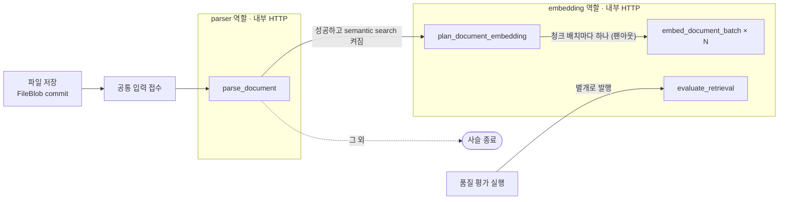
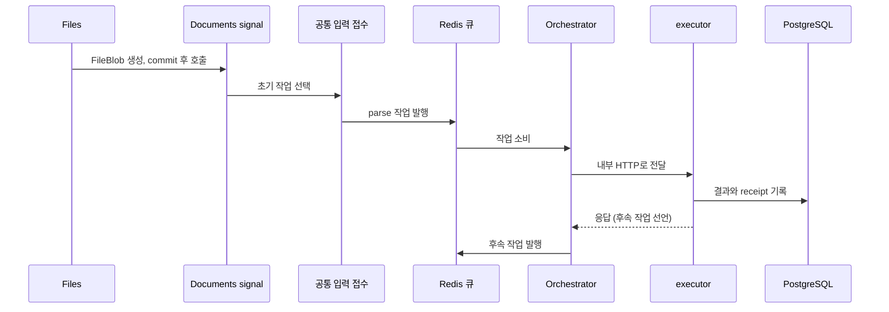
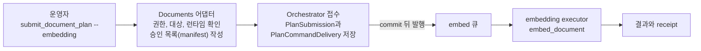

# 처리 파이프라인

> 이전: [오케스트레이션](../blocks/orchestration.md) · 다음: [검색과 RAG](./query.md)

이 문서는 기존 업로드 수집 파이프라인을 자세히 다룹니다. 파일이 저장된 뒤 파싱, 청크 계획, 임베딩으로 이어지는 비동기 사슬의 단계와 제어 흐름을 설명합니다. 이 호환 사슬은 등록된 작업과 도메인 후속 규칙으로 연결되며 사용자가 작성하지 않습니다. 별도로 추가된 명시적 승인 계획 경로는 [오케스트레이션의 실행 흐름](../blocks/orchestration.md#명시적-계획의-실행-흐름)에서 설명합니다. 모든 업로드를 새 계획 경로로 자동 전환하지는 않았습니다.

실행 슬롯과 동시 처리 제한, 큐 깊이 관측은 [오케스트레이션](../blocks/orchestration.md#동시-처리-제한)이, 중복 전달과 receipt의 규칙은 [오케스트레이션](../blocks/orchestration.md#중복-전달과-receipt)이, 단계별 실패와 복구(발행 실패, 응답 유실, 늦은 완료)는 [작업 상태와 정합성](../crosscutting/consistency.md#단계별-실패와-복구)이 다룹니다.

다루지 않는 것: 검색과 RAG는 요청 경로이므로 [검색과 RAG](./query.md)가 다룹니다. 선언의 구조는 [등록부](../blocks/registry.md)가, 큐 소비와 전달은 [오케스트레이션](../blocks/orchestration.md)이 다룹니다.

## 단계

사슬의 시작은 파일 저장 후 공통 입력 접수가 발행하는 `parse_document`입니다. 큐는 각 작업의 전달 경로이며 위 executor 묶음의 소비 주체가 아닙니다. parse와 embed 큐를 소비하는 프로세스는 dotori-orchestrator 하나입니다. 각 단계는 내부 HTTP로 선언된 executor에서 실행되고, 도메인 결과와 receipt를 DB에 기록합니다.

## 작업 실행 구조

이벤트 구독과 문서 enqueue adapter는 Documents에 있습니다. executor는 도메인 결과와 receipt를 DB에 기록하며 Orchestrator는 응답의 후속 작업을 등록 계약으로 발행합니다. 작업을 받는 endpoint는 내부 HTTP 작업을 완료한 뒤 응답하며, 현재 executor의 작업 slot은 하나입니다. 질의 임베딩의 admission과 LLM serving의 동시성·배치는 이 slot과 별개의 계약입니다([검색과 RAG](./query.md)).

## 발행과 복구

signal은 `on_commit`으로 저장 전 소비와 rollback 후 발행을 차단합니다. 발행 실패 시 committed blob과 누락된 parse result가 기존 backlog recovery의 입력으로 남습니다. broker 발행 후 응답 유실 등 중복은 기존 claim과 receipt로 제한합니다.

## 후속 작업의 선언과 발행

이 기존 업로드 경로에서는 executor 안의 handler가 응답에 후속 작업을 선언하고, Orchestrator가 그 선언을 검증한 뒤 등록된 계약으로 발행합니다. 명시적 계획 경로에서는 저장된 승인 step과 현재 의존 산출물 조건을 추가로 확인하므로 executor 제안만으로 계획을 확장할 수 없습니다. 후속 작업의 job_id는 부모 job_id, 작업 종류, 대상 키에서 결정적으로 파생되고 `parent_job_id`가 계보를 남깁니다.

후속을 선언할지는 handler가 정합니다. `parse_document`는 파싱이 성공하고 semantic search 역량이 켜져 있을 때만 후속을 선언하며, 선언이 없으면 사슬은 거기서 끝납니다. `plan_document_embedding`은 청크 배치마다 `embed_document_batch`를 하나씩 선언합니다.

## 명시적 계획 경로

업로드 사슬과 별개로, 운영자가 승인된 계획을 직접 접수하는 경로가 있습니다. 이미 파싱된 문서를 지정해 임베딩을 다시 하거나 빠진 부분만 채울 때 쓰며, `embed_document` 작업이 이 경로의 단계입니다. 업로드 사슬은 그대로 두고 이 경로를 따로 더했습니다.

- 접수하는 명령에는 요청 식별자(`request_id`), 대상 문서, 방식(`missing` 또는 `refresh`)과 선택자(전체 또는 지정한 청크)를 줍니다. 요청 식별자를 다른 계획에 재사용하면 거부합니다.
- 계획은 먼저 저널(`PlanSubmission`)에 저장되고 단계마다 발행 기록(`PlanCommandDelivery`)이 만들어집니다. 발행은 저장이 commit된 뒤에 하며, 발행에 실패해도 계획은 남아 있으므로 `--replay-plan-id`로 다시 발행할 수 있습니다.
- 접수 시점에 Documents 어댑터가 접수한 사람의 멤버십과 문서 대상을 확인하고, 처리할 대상을 승인 목록(`DocumentEmbeddingManifest`)으로 남깁니다. executor 쪽에서 새 대상을 더할 수는 없습니다.

## 사슬 밖의 작업

`evaluate_retrieval`은 `run_uid`로 식별되는 품질 평가 실행(`WorkspaceQualityEvaluationRun`)을 수행합니다. 품질 평가 실행을 시작하는 경로(`documents/search/evaluation.py`)가 발행하며 다른 작업의 후속으로 선언되지 않습니다. 같은 embedding 역할과 `embed` 큐를 쓰므로 수집 작업과 큐를 공유합니다.
