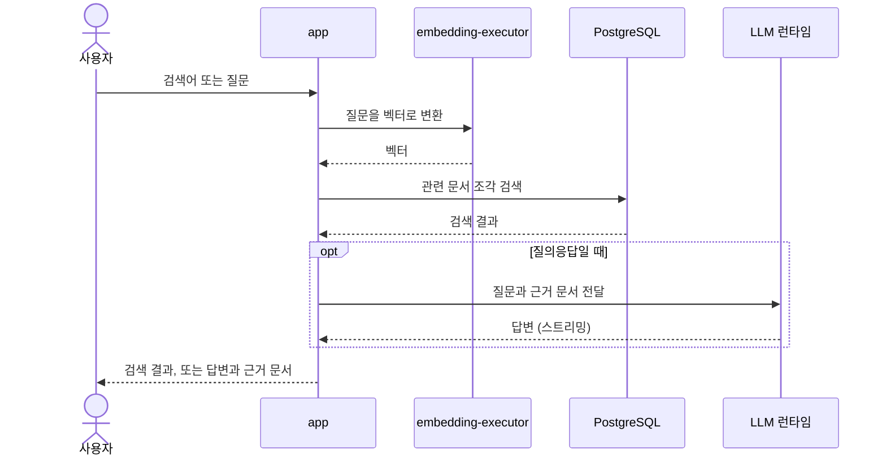
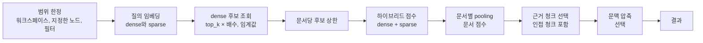
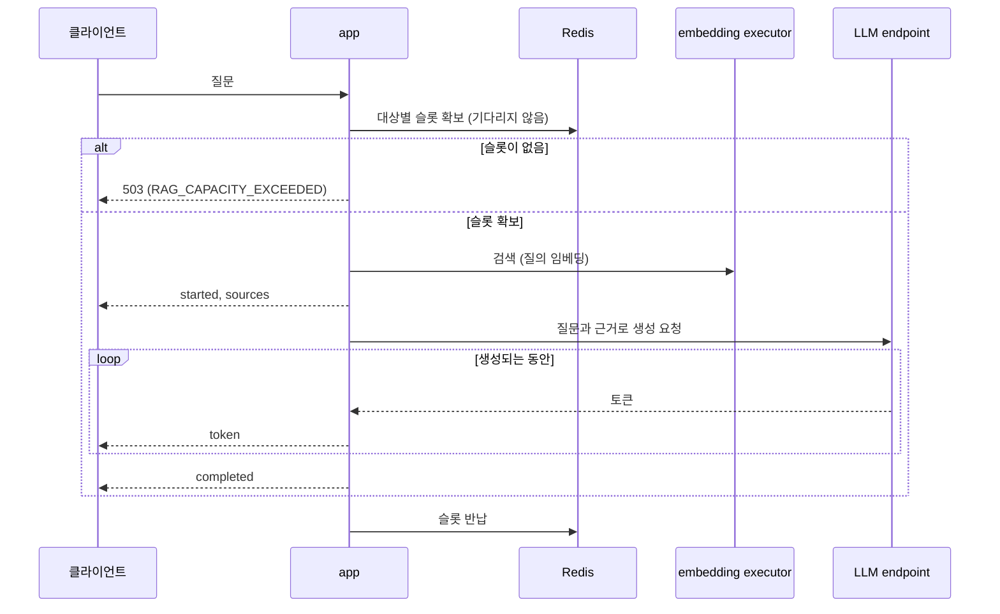

# 검색과 RAG

> 이전: [처리 파이프라인](./pipeline.md) · 다음: [배포](../deployment.md)

이 문서는 사용자가 검색하거나 질문할 때 요청 경로가 어떻게 동작하는지 자세히 다룹니다. 수집 파이프라인과 달리 대기열을 거치지 않는 동기 요청 경로입니다.

검색과 질의 이해는 app의 요청 경로에서 실행합니다. 임베딩은 전용 endpoint에 요청하고, RAG는 ASGI streaming 경로에서 선택한 LLM endpoint를 비동기로 호출합니다. 이 경로를 위한 idle Celery worker는 두지 않습니다.

질의 임베딩은 문서 임베딩과 같은 executor와 같은 admission을 공유하지만 요청 경로에서 직접 호출합니다([Provider](../crosscutting/provider.md)). 질의 임베딩의 admission과 LLM serving의 동시성·배치는 수집 작업의 slot과 별개의 계약입니다.

## 질의 이해

질의 이해는 검색 앞에서 질문을 검색용 질의로 바꾸는 단계입니다. 요청의 `mode`가 `basic`이면 입력을 정규화만 해서 그대로 검색하고, `advanced`일 때만 질의 이해를 적용합니다.

- 질의 이해를 켜지 않은 서버(기본값)에서는 `advanced`여도 정규화만 거치고, 그 사실을 경고(`llm_query_frontend_disabled`)로 계획에 남깁니다.
- 켜져 있으면 파서 서비스가 질문을 의미 질의, 필터, 정렬, 대상 범위로 구조화하고 그 결과를 `QueryUnderstandingLog`에 기록합니다. 구조화에 실패하면 정규화한 원문으로 되돌아가 계속 검색합니다.
- 구조화된 필터는 ORM 조건으로 번역되어 검색의 후보 집합을 좁힙니다. 정렬 조건은 의미 거리가 후보 순서를 정하므로 무시됩니다.

이 기능은 실험 단계입니다([설정 항목](../../reference/configuration.md#실험-단계의-값)).

## 검색

검색은 문서 블록의 리트리버가 요청 프로세스 안에서 실행합니다. 검색 역량이 꺼져 있으면 시작 전에 거부됩니다([기능 활성](../crosscutting/activation.md)).

1. 후보를 워크스페이스(없으면 소유자)로 한정하고, 지정한 노드와 구조화된 필터를 더합니다. 조건에 맞는 임베딩이 없으면 빈 결과를 돌려줍니다.
2. 질의를 임베딩 executor에 보내 dense와 sparse 표현을 얻습니다.
3. dense 거리로 후보를 `top_k`의 배수만큼 가져옵니다. 임계값이 있으면 거리 조건으로 바꿔 이 조회에 적용합니다.
4. 같은 문서에서 후보가 지나치게 몰리지 않도록 문서당 후보 수를 제한합니다.
5. 후보마다 dense 점수와 sparse 점수를 가중합해 하이브리드 점수를 만듭니다.
6. 문서마다 상위 청크의 점수를 pooling해 문서 점수로 합치고, 문서 길이에 따른 약한 감점을 적용합니다.
7. 문서마다 점수가 높은 청크를 근거로 고르고, 설정에 따라 인접 청크를 함께 불러옵니다.
8. 문맥 압축이 켜져 있으면 근거 청크를 구간으로 나눠 질문과 점수가 높은 구간만 남깁니다.

각 단계의 숫자는 [설정 항목](../../reference/configuration.md#하이브리드-검색)의 값이 정합니다.

### 품질 프로파일

위 단계의 값은 서버 기본값과 워크스페이스 프로파일이 함께 정합니다. 서버 기본값은 환경 변수에서 오고, 워크스페이스에 활성 프로파일 개정(`WorkspaceQualityProfileRevision`)이 있으면 그 값이 덮어씁니다. 프로파일은 가중치, 후보 수, pooling 방식, 근거 수 같은 검색 값과 최대 출력 토큰, 온도 같은 생성 값을 담습니다. 값마다 허용 범위와 단계(핵심, 고급)가 스키마로 정해져 있고, 벗어난 값은 검증에서 거부됩니다. 같은 요청이라도 워크스페이스에 따라 결과가 달라질 수 있는 이유입니다.

## RAG 스트리밍과 취소

- **수용 제어**: 요청은 먼저 LLM 대상별 슬롯을 기다리지 않고 확보합니다. 로컬 LLM은 측정으로 정한 동시 처리 수를 쓰고, 외부 endpoint는 endpoint와 모델마다 따로 `RAG_EXTERNAL_LLM_CONCURRENCY`(기본 4)를 씁니다. 외부 endpoint가 로컬 GPU 용량을 소비하지 않습니다. 슬롯이 없으면 앱이나 추론 서버에서 기다리지 않고 바로 503을 돌려줍니다. 슬롯은 스트림이 끝나거나 연결이 끊길 때 반납합니다.
- **검색과 생성**: 검색은 제한된 동기 구간에서 실행하고 `SearchJob`과 `RAGJob`을 기록한 뒤, 생성은 이벤트 루프에서 LLM으로 스트리밍합니다. 근거가 없으면 LLM을 부르지 않고 근거 부족 답변으로 끝납니다.
- **이벤트**: 스트림은 `started`, `sources`로 시작해 `token`이 이어지고 `completed`, `canceled`, `error` 중 하나로 끝납니다([API 계약](../../reference/api-contract-v1.md#rag-요청과-ndjson-event)).
- **취소**: 취소는 두 경로입니다. 취소 요청은 Redis에 신호를 남기고 생성 루프가 이를 확인해 멈춥니다. 클라이언트 연결이 끊기면 위쪽의 LLM 스트림을 직접 닫고 취소된 상태를 기록합니다. 어느 쪽이든 슬롯은 반납됩니다.

## 질의 임베딩의 admission

질의 임베딩은 대기열을 거치지 않고 embedding executor에 직접 요청하지만, 문서 임베딩과 같은 모델 프로세스의 같은 admission 대기열을 지납니다. 이 대기열은 프로세스 안에서 동시 호출 수와 대기 칸 수를 제한하며(`EMBEDDING_MODEL_CONCURRENCY`, `EMBEDDING_REQUEST_QUEUE_CAPACITY`), 질의가 문서보다 먼저 처리됩니다. 실행 중인 작업을 끊지는 않고, 다음 자리가 날 때 우선순위를 적용합니다. 문서가 대기열을 전부 채우지 못하도록 질의 전용 자리를 남깁니다(`EMBEDDING_QUERY_QUEUE_RESERVE`).

대기열이 가득 차거나 기다린 시간이 한도를 넘으면 executor가 바쁘다는 응답을 돌려주고, 검색은 이를 `EMBEDDING_BUSY` 오류로 돌려주고, RAG는 재시도 가능한 503으로 전달합니다. 이 admission은 수집 작업의 executor 슬롯과 별개의 계약입니다([오케스트레이션](../blocks/orchestration.md#동시-처리-제한)).

다루지 않는 것: 문서가 준비되는 비동기 흐름은 [처리 파이프라인](./pipeline.md)이 다룹니다.
