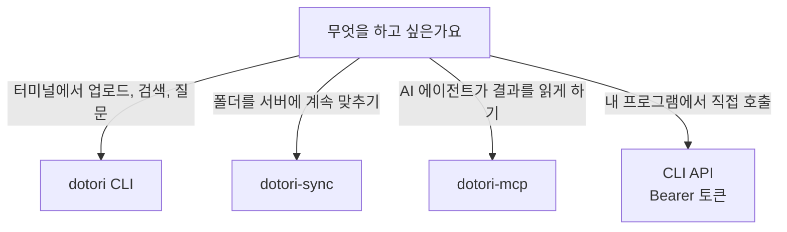

# 연동 가이드

> 이전: [동작 방식](../../overview/how-it-works.md) · 다음: [API 계약](../../reference/api-contract-v1.md)

이 문서는 Dotori에 CLI, 폴더 동기화 클라이언트, MCP 어댑터, 직접 HTTP 호출로 연결하는 방법을 안내합니다. 요청과 응답의 정확한 형식은 [API 계약](../../reference/api-contract-v1.md)이 다루고, 이 문서는 어떤 방법을 고를지와 처음 연결하는 순서를 설명합니다.

## 연동 방법 고르기



| 방법 | 용도 | 권한 | 문서 |
| --- | --- | --- | --- |
| dotori CLI | 업로드, 목록, 검색, 질의응답, 한 번 실행하는 폴더 동기화 | 읽기 전용 또는 읽기·쓰기 토큰 | [CLI README](../../../clients/dotori-cli/README.md) |
| dotori-sync | 폴더를 감시해 계속 서버로 맞추는 상주 프로그램 | 폴더 동기화 토큰 | [Sync README](../../../clients/dotori-sync/README.md) |
| dotori-mcp | AI 에이전트가 준비된 결과를 읽기 전용으로 조회 | 읽기 전용 토큰 | [MCP README](../../../clients/dotori-mcp/README.md) |
| 직접 HTTP 호출 | 위에 없는 연동을 직접 구현 | CLI 토큰 | [API 계약](../../reference/api-contract-v1.md#사용자-cli-api) |

세 클라이언트는 모두 서버 내부 모듈이나 데이터베이스를 쓰지 않고 HTTP API만 호출합니다. 따라서 웹 UI와 같은 권한 검사를 거치고, 비활성화된 기능은 같은 방식으로 거부됩니다.

## 토큰 발급

모든 방법은 사용자별 토큰으로 인증합니다. 웹 UI의 **설정 → 토큰**에서 발급하며, 전체 토큰은 발급할 때 한 번만 보입니다.

| 토큰 종류 | 할 수 있는 일 |
| --- | --- |
| 읽기 전용 | 문서 읽기, 검색, 질의응답, 상태 조회. MCP 어댑터에 적합합니다 |
| 읽기·쓰기 | 읽기 전용의 권한에 문서 업로드가 더해집니다 |
| 폴더 동기화 | 폴더 동기화 전용입니다. 읽기 전용이나 읽기·쓰기 토큰에는 동기화 권한이 없습니다 |

토큰은 계정 소유자의 권한으로 동작합니다. 토큰이 새어 나가면 같은 설정 화면에서 폐기합니다.

## CLI로 시작하기

서버 주소를 `remote`로 한 번 등록하고, 발급한 토큰을 `account`로 등록합니다.

```bash
pipx install -e ./clients/dotori-cli

dotori remote add origin https://dotori.example.com
dotori account add personal --remote origin
dotori account use personal --remote origin

dotori status
dotori list
dotori upload report.pdf
dotori search "계약 해지 조건"
dotori ask "이 계약의 주요 위험을 요약해 줘"
```

`--token`을 생략하면 토큰을 화면에 보이지 않게 입력받습니다. 자동화에서는 `DOTORI_CLI_TOKEN` 환경 변수로 저장된 토큰을 덮어쓸 수 있습니다. 업로드는 읽기·쓰기 토큰이 필요합니다.

## 폴더 동기화

로컬 폴더를 서버의 `/sync/<폴더 이름>` 아래로 한 방향으로 보냅니다. 서버 쪽 변경은 로컬로 내려오지 않습니다.

```bash
# 폴더 동기화 토큰을 같은 계정의 sync 자격으로 등록합니다
dotori account add personal --remote origin --credential sync --token-type sync

dotori --remote origin --account personal sync ~/Documents            # 변경 사항만 미리 보기
dotori --remote origin --account personal sync ~/Documents --apply    # 업로드와 갱신
```

- 기본 동작은 미리 보기(dry run)입니다. `--apply`를 붙여야 반영됩니다.
- 서버에만 있는 항목은 `--delete`를 함께 줄 때만 휴지통으로 옮깁니다.
- 같은 이름의 폴더가 여러 개면 `--root-name`으로 서버 쪽 이름을 구분합니다.
- 심볼릭 링크는 건너뜁니다.

폴더를 계속 맞춰 두려면 `dotori-sync watch ~/Documents`를 씁니다. 파일 변경이 잠잠해지고 5초 뒤에 동기화하고, 놓친 변경을 위해 300초마다 한 번 더 확인합니다. 시작할 때 한 번 동기화한 뒤 감시하며, 일시적인 네트워크 오류는 경고만 남기고 다음 주기에 다시 시도합니다. 한 번만 실행하려면 `--once`를 붙여 cron 같은 곳에서 부릅니다. Windows에서는 `dotori-sync install-menu`로 폴더 오른쪽 클릭 메뉴에 "Sync with Dotori"를 추가할 수 있습니다.

## AI 에이전트에 연결하기

MCP 어댑터는 서버와 별도로 설치하는 읽기 전용 프로세스입니다.

```bash
pipx install ./clients/dotori-mcp
DOTORI_SERVER_URL=http://127.0.0.1:8000 \
DOTORI_TOKEN=dtr_cli_... \
dotori-mcp
```

노출되는 도구는 `server_status`, `capabilities`, `list_documents`, `list_results`, `read_result`, `search`입니다. 업로드, 삭제, 재시도, 워크스페이스 변경 도구는 없습니다. 어댑터가 읽는 결과는 서버가 준비한 처리 결과이므로, 기능이 꺼져 있거나 문서가 아직 처리되지 않았다면 해당 결과는 없습니다.

## 직접 HTTP 호출

`/api/cli/v1/` 아래의 endpoint는 모두 `Authorization: Bearer <토큰>`을 요구하고 쿠키와 CSRF는 쓰지 않습니다. 각 endpoint는 토큰의 권한 범위를 다시 검사합니다.

| 하려는 일 | 요청 | 필요한 권한 |
| --- | --- | --- |
| 토큰 확인 | `GET /api/cli/v1/identity/` | 유효한 토큰 |
| 서버 상태 | `GET /api/cli/v1/status/` | 상태 읽기 |
| 문서 목록 | `GET /api/cli/v1/documents/` | 문서 읽기 |
| 업로드 | `POST /api/cli/v1/upload/` | 문서 쓰기 |
| 검색 | `POST /api/cli/v1/search/` | 검색 |
| 질의응답 | `POST /api/cli/v1/ask/stream/` | 질의응답 |

검색은 JSON으로 질문을 보내면 한 번에 결과를 돌려줍니다.

```bash
curl -s https://dotori.example.com/api/cli/v1/search/ \
  -H "Authorization: Bearer $DOTORI_TOKEN" \
  -H "Content-Type: application/json" \
  -d '{"mode": "basic", "query": "계약 해지 조건", "top_k": 5}'
```

질의응답은 답변이 만들어지는 대로 한 줄씩 JSON을 흘려 보내는 스트림(NDJSON)입니다.

```bash
curl -N https://dotori.example.com/api/cli/v1/ask/stream/ \
  -H "Authorization: Bearer $DOTORI_TOKEN" \
  -H "Content-Type: application/json" \
  -d '{"question": "이 계약의 해지 조건을 알려줘", "language": "ko", "top_k": 3}'
```

스트림은 `started`, `sources`로 시작해 `token`이 이어지고 `completed`, `canceled`, `error` 중 하나로 끝납니다. 동시 처리 용량이 없거나 LLM 런타임을 쓸 수 없으면 스트림을 열기 전에 JSON `503`이 오며, 이때는 잠시 뒤에 다시 시도합니다. 각 event의 필드와 오류 코드는 [API 계약](../../reference/api-contract-v1.md#rag-요청과-ndjson-event)에 있습니다.

## 어떤 결과를 읽을 수 있나요

검색과 질의응답은 문서가 처리된 만큼만 동작합니다. 설치 모드에 따라 결과가 없는 경우가 있습니다.

| 설치 모드 | 읽을 수 있는 것 |
| --- | --- |
| 기본 | 파일 목록과 업로드만 가능하고 검색과 질의응답은 쓸 수 없습니다 |
| Hybrid/Search AI | 검색은 가능하고 질의응답은 쓸 수 없습니다 |
| Full 로컬 AI RAG | 검색과 질의응답을 모두 쓸 수 있습니다 |

서버가 어떤 기능을 켜고 있는지는 `GET /api/cli/v1/status/`나 `dotori status`로 확인합니다.

## 알아두어야 할 것들

- 질의응답에 쓰는 모델은 서버 전체에서 하나입니다. 요청마다 모델을 고를 수 없습니다.
- 결과를 읽는 쪽에서는 문서를 올린 직후 바로 검색되지 않을 수 있습니다. 파싱과 임베딩이 끝나야 검색 대상이 됩니다([동작 방식](../../overview/how-it-works.md#문서-파일을-올리면-어떻게-처리되나요)).
- 서버의 임베딩 모델이 바뀌면 기존 문서를 다시 처리하는 동안 검색 결과가 달라질 수 있습니다([임베딩 런타임 가이드](../operate/embedding-guide.md)).
