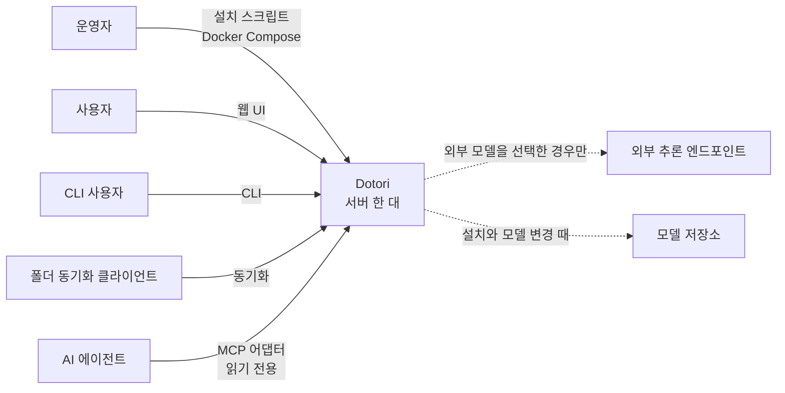
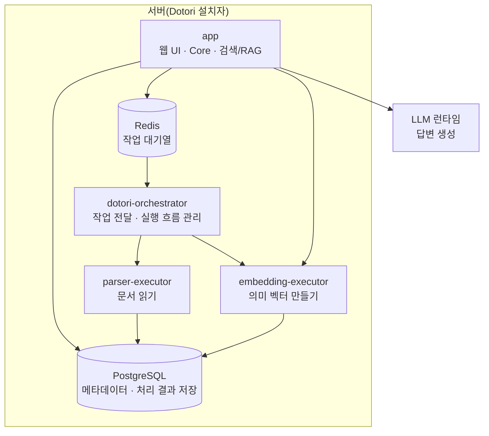
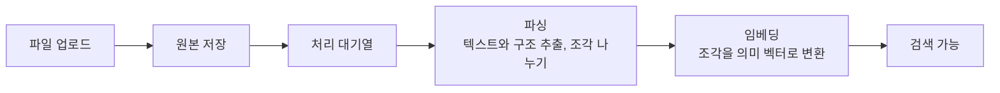
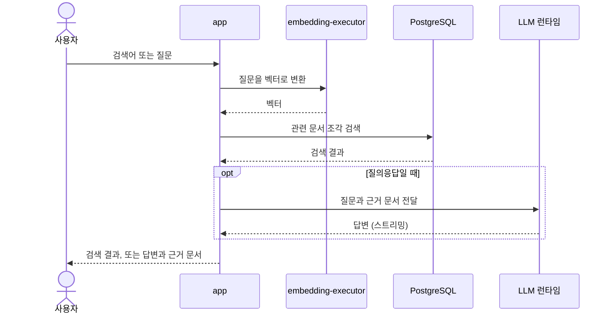
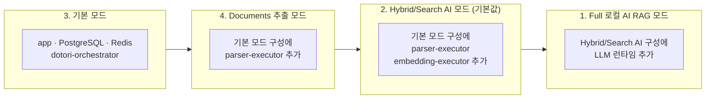

# Dotori는 어떻게 동작하는가

> 이전: [Dotori란 무엇인가](./what-is-dotori.md) · 다음: 운영자는 [설치 가이드](../guides/install/installation-guide.md), 통합 개발자는 [연동 가이드](../guides/integrate/README.md), 기여자는 [아키텍처](../architecture/README.md)

이 문서는 Dotori가 어떤 서비스로 이루어져 있고 파일과 질문이 어떻게 흐르는지 도식으로 보여 줍니다.

## 누가 어떻게 접근하나요

웹 UI는 로그인 세션으로, CLI와 폴더 동기화 클라이언트, MCP 어댑터는 사용자별 토큰으로 접속합니다. 서버 안쪽의 처리 서비스는 밖으로 열리지 않습니다. 외부에서 접속하려면 선택적인 리버스 프록시(HTTPS)를 켭니다. 인터페이스별 인증과 외부 시스템은 [인터페이스](../reference/interfaces.md)에 정리했습니다.

## 어떤 서비스로 이루어져 있나요

- app: 웹 UI와 API, 파일 저장·권한 등 Core 기능과 검색·RAG 요청 처리를 제공합니다. Core만을 위한 컨테이너는 아닙니다.
- dotori-orchestrator: 처리 대기열에서 작업을 꺼내 알맞은 처리 서비스에 차례로 전달합니다.
- parser-executor: 문서를 읽어 텍스트와 구조를 추출하고 검색에 쓸 조각(청크)으로 나눕니다.
- embedding-executor: 문서 조각과 질문을 의미 벡터로 바꿉니다. 로컬 임베딩 모델은 이 서비스만 올립니다. 외부 임베딩 API를 쓰는 경우에도 이 서비스를 거칩니다.
- PostgreSQL: 계정, 파일 메타데이터, 처리 결과와 작업 기록을 저장합니다. 원본 파일의 내용은 별도 파일 저장소에 보관합니다.
- Redis: 처리 작업의 대기열입니다.
- LLM 런타임: 질의응답의 답변을 만듭니다. 서버 하드웨어에 맞춰 설치한 로컬 런타임이나 운영자가 연결한 외부 모델을 씁니다.

executor는 오케스트레이터가 전달한 작업을 실제로 수행하는 서비스를 뜻합니다.

## 문서 파일을 올리면 어떻게 처리되나요

문서 상세 화면에서 업로드, 파싱, 임베딩 단계별 처리 상태를 볼 수 있습니다. 파싱과 임베딩은 각 실행 서비스의 처리 한도 안에서 진행하므로, 한꺼번에 많이 올리면 대기열에 쌓입니다. 기본 모드는 원본 저장까지만, 추출 모드는 파싱까지만 진행합니다. [첫 문서로 시작하기](../guides/use/first-document.md)에서 완료 확인 방법을 안내합니다.

## 검색하고 질문하면 어떻게 동작하나요

문서와 질문은 같은 임베딩 모델로 벡터를 만듭니다. 그래서 임베딩 모델을 바꾸면 기존 문서를 다시 처리해야 할 수 있습니다. 자세한 내용은 [임베딩 런타임 가이드](../guides/operate/embedding-guide.md)에 있습니다. 질문을 대화로 이어 가는 방법은 [대화형 RAG 채팅](../reference/RAG_session.md)에 있습니다.

## 설치 모드에 따라 무엇이 켜지나요

- 기본 모드: AI 기능 없이 파일 업로드와 관리만 합니다.
- Documents 추출 모드(설치 옵션 4): 기본 구성에 parser-executor를 추가하여 텍스트와 구조를 추출합니다. 의미 검색과 답변 생성은 하지 않습니다.
- Hybrid/Search AI 모드: 문서를 분석하고 임베딩해 하이브리드 검색을 합니다. LLM 답변 생성은 하지 않습니다.
- Full 로컬 AI RAG 모드: 위 기능에 더해 로컬 LLM으로 질의응답 답변을 만듭니다.

## 설계 목표에 대해 정리하자면

- 시스템의 자원 소모를 줄이기 위해 쓰지 않는 기능은 올리지 않도록 설계하였습니다. 설치할 때 고른 기능의 서비스만 시작됩니다.
- 같은 모델을 여러 서비스가 중복해서 올리지 않도록, 로컬 모델은 전용 서비스 하나에서만 올립니다.
- 웹 서비스는 가볍게 유지합니다. 모델 추론은 전용 서비스에서 수행하여 웹 서비스의 영향을 줄였습니다.
- 임베딩 모델은 서버 전체에서 하나를 사용하고 관리형 로컬 LLM은 선택된 하나를 실행합니다. 외부 LLM endpoint는 별도로 등록할 수 있습니다. 서버 공통 설정은 설치하거나 모델을 바꿀 때 정하며, 변경은 서비스를 다시 시작해야 반영됩니다. 변경별 방법은 [설정 변경 적용](../guides/operate/applying-changes.md)에서 다룹니다.
- 모델 파일은 제품 이미지와 따로 받습니다. 인터넷이 없는 환경에서 Dotori를 사용하기 위해서는 최초 설치 시 모델 파일을 같이 다운받아야 합니다.
