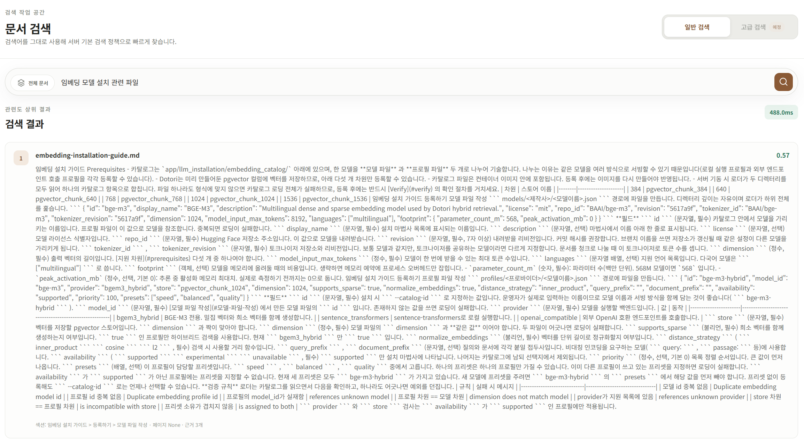
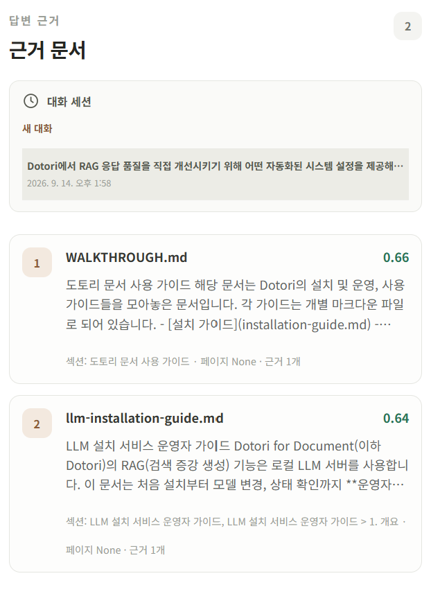
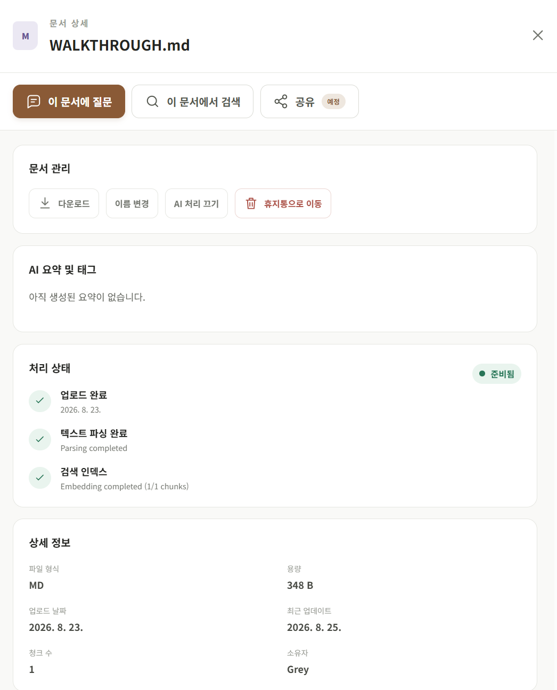
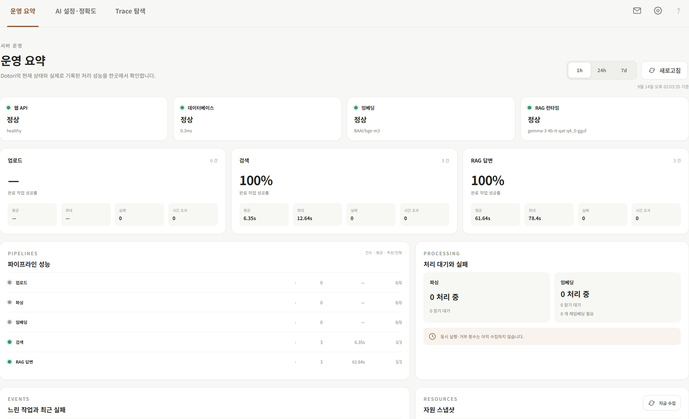

# 화면 둘러보기

> 이전: [Dotori란 무엇인가](./what-is-dotori.md) · 다음: [동작 방식](./how-it-works.md)

이 문서는 Dotori의 주요 화면을 스크린샷으로 보여 줍니다.

## 문서 검색

자연어로 검색하면 관련도 높은 문서를 순서대로 보여 줍니다.

## RAG 채팅과 답변 근거

질문에 대한 답변과 함께, 답변의 근거가 된 문서를 관련도 점수와 함께 확인할 수 있습니다.

## 문서 상세

문서별 업로드, 파싱, 임베딩 처리 상태와 메타데이터를 확인합니다.

## 운영 요약

관리자는 서버 상태와 최근 처리 성능을 한 화면에서 확인합니다. 자세한 내용은 [모니터링 가이드](../guides/operate/monitoring-and-quality-guide.md)를 참고하세요.

