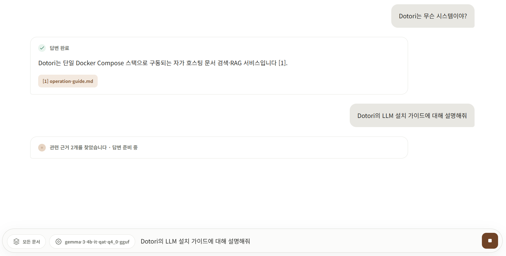

# 대화형 RAG 채팅

> 이전: [동작 방식](../overview/how-it-works.md) · 다음: [API 계약](./api-contract-v1.md)

채팅 화면에서 문서에 대해 나눈 질문과 답변은 하나의 대화(세션, session)로 저장되어, 나중에 같은 화면에서 다시 열어볼 수 있습니다.

## 1. 대화란 무엇인가

문서 목록이나 폴더에서 채팅으로 들어가 질문하면, 그 질문과 답변은 워크스페이스에 속한 하나의 대화에 묶여 저장됩니다. 채팅을 열 때마다 매번 새로 시작하는 것이 아니라, 사이드바의 **대화 세션** 목록에서 이전 대화를 골라 이어볼 수 있습니다.

- **대화**: 제목과 기본 검색 범위를 가진, 워크스페이스에 저장되는 채팅 기록 단위입니다. 제목은 첫 질문에서 자동으로 만들어지며, 나중에 직접 바꿀 수 있습니다.
- **메시지**: 대화 안에서 주고받은 질문 하나, 답변 하나를 말합니다.
- **기본 검색 범위**: 그 대화의 질문이 검색할 문서/폴더 범위입니다. 비워두면 워크스페이스의 모든 문서를 대상으로 검색합니다.

### 언제 새 대화가 만들어지나

문서 목록이나 폴더 상세에서 채팅으로 들어가면 자동으로 새 대화가 시작됩니다. 사이드바의 **새 대화** 버튼으로 직접 새로 시작할 수도 있습니다. 같은 주제를 이어가려면 새로 만들지 말고 대화 세션 목록에서 기존 대화를 다시 여세요.

## 2. 사용하기

### 이어보기

대화는 URL(`/workspace/chat/{대화 id}/`)에 묶여 있어서, 새로고침하거나 다른 시점에 다시 접속해도 그 대화의 질문/답변 목록이 그대로 복원됩니다. 사이드바에서 다른 대화로 언제든 전환할 수 있습니다.

### 예시: 질문하고 나중에 다시 열어보기

1. 정책 문서가 있는 폴더에서 채팅을 엽니다. 새 대화가 자동으로 시작됩니다.
2. "운영 정책의 핵심 원칙은?" 같은 질문을 보내면, 답변이 실시간으로 생성되며 근거가 된 문서가 함께 표시됩니다.
3. 나중에 사이드바의 대화 세션 목록에서 같은 대화를 다시 엽니다. 지난 질문과 답변이 그대로 남아 있습니다.
4. 이어서 다른 질문을 입력하면 새 메시지로 같은 대화에 추가됩니다.
5. 만약 답변 생성이 실패했거나 중간에 끊겼다면, 그 메시지의 **다시 시도** 버튼으로 같은 질문을 다시 보낼 수 있습니다.

### 대화 설정 바꾸기

사이드바의 **대화 관리**에서 **대화 설정**을 열면 제목과 기본 검색 범위를 바꿀 수 있습니다. **변경 저장**을 누르면 반영됩니다. 다른 곳(다른 탭이나 다른 구성원)에서 같은 대화가 먼저 바뀌었다면 저장이 거부되고, 대화를 다시 연 뒤 시도하라는 안내가 표시됩니다.

### 생성 중단하기

답변을 만드는 중에는 **생성 중단** 버튼으로 즉시 멈출 수 있습니다. 중단된 답변에도 다시 시도 버튼이 붙어, 원래 질문을 다시 보낼 수 있습니다.

### 대화 삭제하기

**대화 삭제**를 누르면 목록과 화면에서 대화가 사라지며, 이 작업은 되돌릴 수 없습니다. 답변을 생성하고 있는 대화는 바로 삭제되지 않습니다 — 먼저 생성을 중단해야 합니다. 방금 중단을 요청한 직후라면, 화면이 중단 처리를 잠시 기다렸다가 삭제를 자동으로 다시 시도합니다.

### 누가 보고 누가 답할 수 있는가

같은 워크스페이스의 구성원은 서로의 대화를 볼 수 있습니다. 다만 질문을 보내거나 제목/검색 범위를 바꾸거나 삭제하는 것은 **작성자 본인과 워크스페이스 관리자**만 할 수 있습니다. 다른 구성원에게는 대화가 읽기 전용으로 표시되고, 입력창에 "이 대화는 읽기 전용입니다. 작성자 또는 워크스페이스 관리자만 질문하거나 설정을 변경할 수 있습니다"라는 안내가 뜹니다.

## 3. 알아두어야 할 것들

- **이전 턴을 이해하고 답하지는 않습니다.** 같은 대화 안에서 여러 질문과 답변을 모아 볼 수는 있지만, 답변을 만들 때 이전 턴의 내용을 참고하지는 않습니다. 각 질문은 매번 새로운 독립된 질문으로 처리되므로, "그 문서", "방금 그거"처럼 이전 턴을 가리키는 표현은 이해하지 못합니다. 문서를 특정해서 물어보려면 질문마다 필요한 내용을 다시 적어야 합니다.
- **대화 세션 목록은 최근 대화 위주로만 보여줍니다.** 아주 오래된 대화를 찾을 때는 스크롤보다 제목으로 구분해서 찾아야 할 수 있습니다.
- **한 번에 한 명만 답을 받을 수 있습니다.** 같은 대화에서 이미 답변을 생성하고 있다면, 완료되기 전까지는 같은 대화로 새 질문을 보낼 수 없습니다.
- **여러 명이 동시에 같은 대화를 편집할 수는 없습니다.** 작성자와 워크스페이스 관리자가 번갈아 가며 사용하는 형태이며, 공동 편집 기능은 없습니다.

## 관련 문서

- [LLM 설치 가이드](../guides/install/llm-installation-guide.md) — 답변을 생성하는 로컬 LLM을 선택하고 설치하기
- [임베딩 런타임 가이드](../guides/operate/embedding-guide.md) — 답변 근거를 찾는 검색 임베딩 모델 전환하기
- [운영 가이드](../guides/operate/operation-guide.md) — RAG 동시 처리 한도, 타임아웃 등 서버 파라미터 조정
