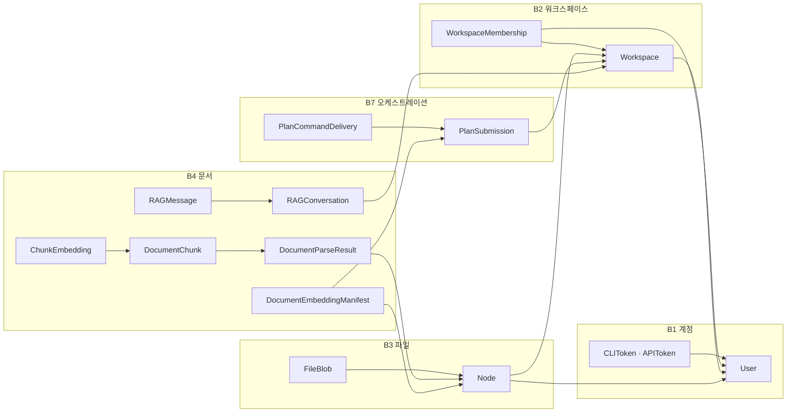

# 데이터 모델

> 이전: [아키텍처](../architecture/README.md)

이 문서는 블록별로 소유하는 상태를 한곳에 모아 조회할 수 있게 합니다. 상태는 DB 테이블, 호스트의 파일, 코드의 선언 상수 중 하나에 저장됩니다. 한 블록이 소유한 상태를 다른 블록은 직접 쓰지 않으며, 이 규칙은 [블록 경계 규칙](../architecture/crosscutting/boundaries.md)이 다룹니다.

## 저장 방식

| 방식 | 소유하는 블록 | 내용 |
| --- | --- | --- |
| DB 테이블 | B1 계정, B2 워크스페이스, B3 파일, B4 문서, B7 오케스트레이션 | 아래 블록별 표 |
| 호스트의 파일 | B5 설치와 런타임 | `data/config/` 아래의 설치 계획(`deployment_plan.json`)과 런타임 설정(`embedding_runtime.json`, `llm_runtime.json`) |
| 코드의 선언 상수 | B6 등록부와 판정 | 역량, 모듈, 작업 종류, 실행 역할의 선언 |

테이블 이름은 `<앱 이름>_<모델 이름의 소문자>`입니다. 문서 블록의 앱 이름은 `documents`이므로 테이블이 `documents_*`로 시작합니다. 한 가지 예외로, B7의 `PlanSubmission`은 문서 블록에서 옮겨 오기 전의 이름을 유지해 `documents_plansubmission` 테이블을 씁니다.

## 블록 사이의 참조

화살표는 외래 키가 가리키는 방향입니다. 참조는 한 방향으로만 흐르며, B7은 B4의 테이블을 참조하지 않습니다.

## B1 계정

| 모델 | 저장하는 것 |
| --- | --- |
| `User` | 이메일로 로그인하는 계정입니다. 표시 이름, 활성 여부, staff 여부, 이메일 인증 상태를 가집니다 |
| `CLIToken` | 사용자용 CLI의 Bearer 토큰입니다. 원문 대신 해시를 저장합니다 |
| `APIToken` | 폴더 동기화 클라이언트가 쓰던 이전 방식의 토큰입니다 |

## B2 워크스페이스

| 모델 | 저장하는 것 |
| --- | --- |
| `Workspace` | 협업 단위입니다 |
| `WorkspaceMembership` | 사용자가 어느 워크스페이스에 속하는지와 초대한 사람입니다 |
| `WorkspaceInviteCode` | 초대 코드입니다. 코드 원문 대신 digest를 저장하며 사용 횟수와 만료 시각을 가집니다 |
| `WorkspaceInvitation` | 특정 사용자에게 보낸 초대와 수락 상태입니다 |

## B3 파일

| 모델 | 저장하는 것 |
| --- | --- |
| `Node` | 폴더 트리의 파일과 폴더입니다. 소유자, 워크스페이스, 부모 노드를 가집니다 |
| `FileBlob` | 파일의 원본과 그 정보(해시, 크기, MIME 형식)입니다 |
| `FileOperationLog` | 파일 관리 API 요청 한 건당 한 줄의 기록입니다 |
| `UserStorage` | 사용자와 워크스페이스별 저장 용량입니다 |

## B4 문서

| 구분 | 모델 | 저장하는 것 |
| --- | --- | --- |
| 파싱 | `DocumentParseResult` | 파일의 파싱 결과 요약입니다. 파서, 상태, 청크 수를 가집니다 |
| 파싱 | `DocumentChunk` | 검색에 쓰는 문서 조각입니다 |
| 임베딩 | `EmbeddingGeneration` | 임베딩 런타임의 세대입니다. 모델, Provider, 차원과 진행한 청크 수를 가집니다 |
| 임베딩 | `ChunkEmbedding` | 청크별 벡터 결과와 상태입니다 |
| 임베딩 | `ChunkSegmentEmbedding` | 문맥 압축이 필요할 때 만드는 구간 단위 임베딩입니다 |
| 임베딩 | `DocumentEmbeddingManifest` | 접수된 계획에서 승인된 임베딩 대상 목록과 지문입니다 |
| 작업 | `ExecutorJobReceipt` | job의 식별자, 상태, 시도 횟수, 결과 요약입니다. 문서 내용과 벡터는 담지 않습니다 |
| 작업 | `ResourceSnapshot` | 운영자가 수동 명령으로 남기는 자원 사용량 한 줄입니다 |
| 검색 | `SearchJob` | 검색 요청 한 건의 기록입니다 |
| 검색 | `QueryUnderstandingLog` | 질의 이해 단계의 입력과 해석 결과입니다 |
| RAG | `RAGJob` | 질의응답 요청 한 건과 그 진행 상태입니다 |
| RAG | `RAGConversation` | 워크스페이스 안의 대화 단위입니다 |
| RAG | `RAGMessage` | 대화 안의 질문과 답변입니다 |
| RAG | `LLMEndpoint` | 사용자가 등록한 OpenAI 호환 LLM 엔드포인트입니다 |
| RAG | `UserLLMPreference` | 워크스페이스 단위의 LLM 기본 설정입니다 |
| 품질 | `WorkspaceQualityProfileRevision` | 워크스페이스 검색 품질 프로파일의 개정 이력입니다 |
| 품질 | `WorkspaceEvaluationDataset` | 품질 평가에 쓰는 데이터셋입니다 |
| 품질 | `WorkspaceQualityEvaluationRun` | 데이터셋과 프로파일 개정으로 수행한 평가 실행입니다 |

## B7 오케스트레이션

| 모델 | 저장하는 것 |
| --- | --- |
| `PlanSubmission` | 접수된 계획입니다. 요청과 job 식별자, 워크스페이스, 계획 정의와 발행 결과를 가집니다 |
| `PlanCommandDelivery` | 승인된 단계의 식별과 발행 기록(저널)입니다. 실행 receipt가 아닙니다 |

## 호스트 파일과 선언 상수

| 상태 | 위치 | 블록 |
| --- | --- | --- |
| 설치 계획 | `data/config/deployment_scopes/…/deployment_plan.json` | B5 |
| 임베딩 런타임 설정 | `data/config/runtime_scopes/production/embedding_runtime.json` | B5 |
| LLM 런타임 설정 | `data/config/llm_runtime.json` | B5 |
| 역량, 모듈, 작업 종류, 실행 역할 | `app/capabilities/`의 코드 상수 | B6 |

이 파일들은 호스트의 `data/` 아래에 있고 저장소에 포함되지 않습니다. 설정이 프로세스에 적용되는 시점은 [설정 변경 적용](../guides/operate/applying-changes.md)이 다룹니다.

다루지 않는 것: 필드 하나하나의 정의는 소스의 모델 클래스가 다룹니다. 쓰기 규칙은 [블록 경계 규칙](../architecture/crosscutting/boundaries.md)이 다룹니다.
